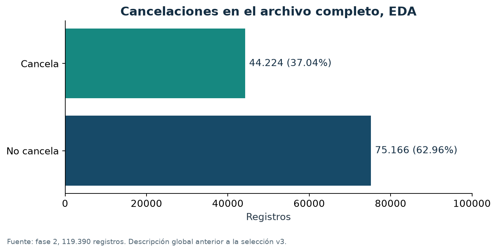
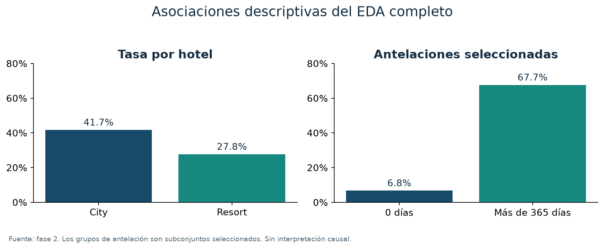
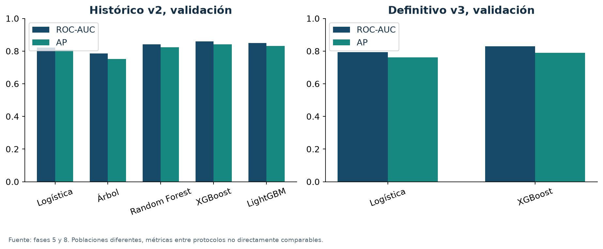
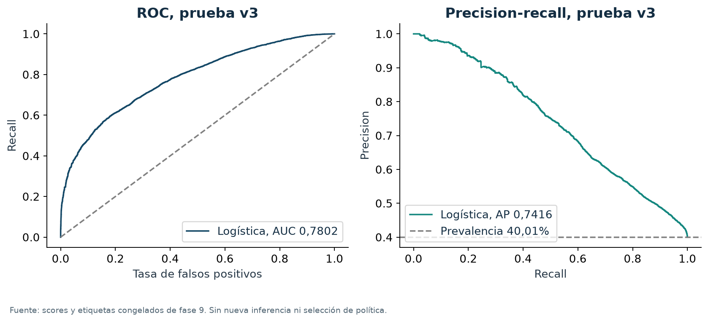
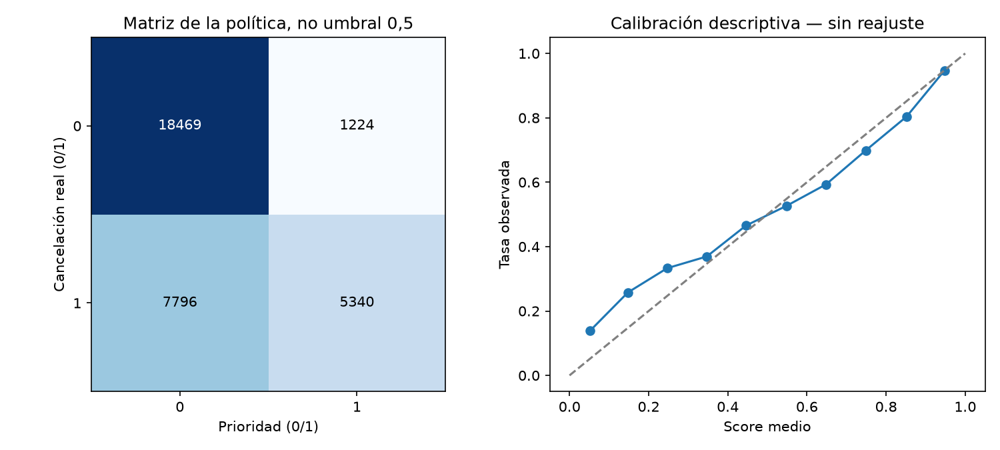
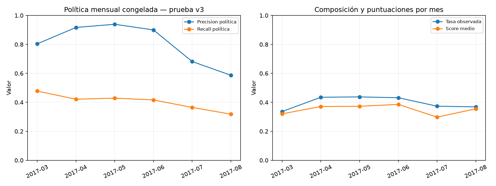
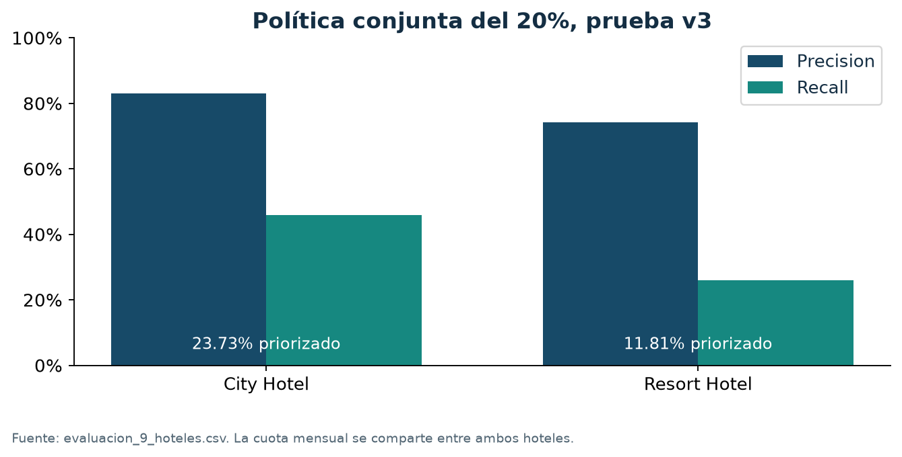

# Predicción de cancelaciones hoteleras

## Memoria académica final

Curso de Data Science y Machine Learning. Fecha: 18 de octubre de 2026.

Autoría: no consta un nombre académico confirmado en los materiales disponibles. No se infiere a partir del usuario del sistema.

Protocolo definitivo: v3, cohortes retrospectivas por fecha de llegada. Modelo: regresión logística inicial. Política: priorización mensual del 20% para seguimiento humano.

## Resumen ejecutivo

El proyecto estudia la clasificación de cancelaciones a partir de 119.390 registros de dos hoteles. Su finalidad académica es construir una metodología reproducible que separe preparación, selección y evaluación, y que traduzca las puntuaciones del modelo en una política explícita de seguimiento. La utilidad potencial consiste en orientar una capacidad limitada de revisión de reservas. Los datos no permiten estimar el efecto de contactar a los clientes ni un ahorro económico.

Se conservan todos los registros y se seleccionan 14 predictores mediante criterios de disponibilidad y semántica. Los imputadores, codificadores y escaladores se ajustan exclusivamente con entrenamiento. El protocolo definitivo separa cohortes por llegada, con dos períodos de embargo y una comprobación común de seguimiento. Es un estudio retrospectivo: faltan snapshots iniciales y un cierre operativo acreditado, y parte de la prueba tuvo exposición previa en el desarrollo metodológico.

La comparación definitiva utiliza logística y XGBoost iniciales en validación v3. XGBoost ofrece mejor ROC-AUC y Average Precision globales. A una capacidad mensual fijada hipotéticamente en el 20%, logística identifica 3.407 cancelaciones frente a 3.375 de XGBoost, con idénticas 3.980 prioridades. La pequeña ventaja descriptiva y su menor complejidad motivan seleccionar logística. No se afirma superioridad estadística universal.

La evaluación final única comprende 32.829 reservas de marzo a agosto de 2017. Se priorizan 6.564, de las cuales 5.340 cancelan y 1.224 no cancelan. Precision alcanza 81,35%, recall 40,65% y F1 0,5421. ROC-AUC es 0,7802, AP 0,7416 y Brier 0,18534. Se omiten 7.796 cancelaciones. El rendimiento disminuye respecto a validación y presenta variabilidad mensual, especialmente en julio y agosto. Se mantiene la especificación sin reajustes.

## 1. Introducción y problema de negocio

Las cancelaciones introducen incertidumbre en la demanda que finalmente se materializa. Una puntuación de riesgo podría ayudar a ordenar revisiones humanas, pero predecir una cancelación y evitarla son problemas distintos. Este trabajo aborda el primero y diseña una regla académica de priorización. No evalúa intervenciones, penalizaciones, sobreventa ni cambios de precios.

La unidad observada es una fila de reserva del archivo disponible. No existe un identificador real que permita confirmar si filas idénticas corresponden a reservas diferentes o a duplicación técnica. Esta ambigüedad condiciona tanto la calidad como la interpretación del tamaño muestral.

El escenario inicial de anticipación al crear una reserva exige información histórica que el CSV no acredita. Por ello, el alcance final se limita a evaluar retrospectivamente cohortes de llegada. Esta definición es parte de la pregunta de investigación y debe acompañar a las métricas.

## 2. Objetivos y alcance académico

El objetivo principal es evaluar la capacidad de un clasificador para priorizar cancelaciones en una población retrospectiva definida, con preparación reproducible y una política de capacidad fijada antes de prueba.

Los objetivos específicos son describir calidad y asociaciones; separar información predictiva de desenlaces y metadatos; comparar familias de clasificadores; estudiar optimización y explicabilidad en el experimento histórico correspondiente; justificar un protocolo temporal defendible dentro de las limitaciones; seleccionar modelo y política mediante validación; y documentar una evaluación final trazable.

Se revisaron los proyectos anteriores de Python y Estadística del curso, sus README y notebooks, así como los informes y notebooks de este proyecto. Se conserva la estructura data/raw, data/processed, notebooks, src y reports, con explicación en español y código modular. No se ha localizado el enunciado original ni una rúbrica del profesor. Esta memoria sigue la estructura solicitada por el usuario y no inventa algoritmos obligatorios, extensión, duración o formato de entrega del centro.

## 3. Dataset y procedencia

El archivo local se extrajo de Curso/MachineLearning/archive.zip, que contiene hotel_bookings.csv. Tiene 119.390 filas y 32 columnas. Su estructura y tamaños son compatibles con Hotel Booking Demand, publicado por António, de Almeida y Nunes [1]. El artículo describe dos conjuntos con 31 variables y 40.060 y 79.330 reservas; la versión combinada local añade la columna hotel. Esta correspondencia no certifica la cadena de descarga, versión o licencia específica del ZIP local.

Las llegadas previstas abarcan del 1 de julio de 2015 al 31 de agosto de 2017. Solo 2016 contiene los doce meses calendario. La variable objetivo is_canceled vale 1 en una cancelación y 0 en caso contrario. No presenta ausentes.

| Población descriptiva completa | Reservas | Cancelaciones | Tasa |
|---|---:|---:|---:|
| City Hotel | 79.330 | 33.102 | 41,73% |
| Resort Hotel | 40.060 | 11.122 | 27,76% |
| Total | 119.390 | 44.224 | 37,04% |

Fuente: inspección y EDA completos, fases 1 y 2. Estas cifras describen todo el archivo, no la prueba v3.

## 4. Análisis exploratorio y calidad

El EDA revela diferencias entre hoteles y asociaciones con la antelación y el segmento. Con antelación cero hay 6.345 reservas y 430 cancelaciones (6,78%); por encima de 365 días, 3.148 y 2.130 (67,66%). Groups presenta 61,06% de cancelación y Online TA 36,72%. Son asociaciones agregadas que pueden reflejar temporada, composición y proceso de registro. No estiman efectos causales.

Figura 1. Distribución de is_canceled en las 119.390 filas. Fuente: reports/eda_resumen.json e informe de fase 2. La clase mayoritaria es no cancelación, pero la cancelación tiene suficiente presencia para requerir métricas de detección además de accuracy.

Figura 2. Dos asociaciones descriptivas del EDA completo: tasas por hotel y antelaciones extremas seleccionadas. Fuente: fase 2. Los grupos de antelación mostrados son subconjuntos, no una partición exhaustiva. No implican que modificar la antelación cambie el resultado.

| Campo | Ausentes | Decisión relevante |
|---|---:|---|
| children | 4 | Indicador de ausencia e imputación mediana en train |
| country | 488 | Categoría constante Desconocido |
| agent | 16.340 | Excluido de X |
| company | 112.593 | Excluido de X |

Hay 31.994 repeticiones exactas adicionales y 40.165 filas participantes en grupos repetidos. Se conservan porque no existe evidencia suficiente para distinguir duplicados técnicos de reservas legítimas iguales. Los manifiestos comprueban que los grupos exactos no cruzan particiones de modelado. La dependencia residual entre clientes o grupos no puede descartarse.

Se detectan 715 estancias de cero noches y 180 registros con cero huéspedes conocidos. ADR incluye un valor negativo y un extremo de 5.400. No se borran filas ni se recortan extremos automáticamente. ADR se excluye de los predictores; sus incidencias se conservan como metadatos. Las anomalías pueden solaparse y no deben sumarse como exclusiones.

El EDA solicitado utilizó todo el archivo antes de fijar la prueba definitiva. Por tanto, la exposición exploratoria global se declara expresamente y no se presenta el conjunto final como completamente desconocido durante todo el proyecto.

## 5. Preparación y prevención de fuga de información

Se preservan las 119.390 filas. El archivo preparado contiene los predictores, la etiqueta separada y metadatos técnicos. Los identificadores de fila, fechas completas, grupos de duplicados y flags de calidad sirven para auditoría, y no entran en X.

Los seis predictores numéricos son lead_time, total_nights, adults, children, babies y children_missing. total_nights suma noches de fin de semana y entre semana; children_missing identifica un dato desconocido sin imputarlo previamente. Los ocho categóricos son hotel, arrival_date_month, meal, country, market_segment, distribution_channel, reserved_room_type y customer_type.

Se excluyen reservation_status y reservation_status_date porque describen el desenlace. También se excluyen assigned_room_type, booking_changes, days_in_waiting_list, deposit_type, adr, total_of_special_requests, required_car_parking_spaces, previous_cancellations, previous_bookings_not_canceled, is_repeated_guest, agent y company por incertidumbre sobre su versión o disponibilidad histórica. Una asociación intensa no prueba por sí sola leakage, y una asociación débil tampoco garantiza disponibilidad.

El pipeline de scikit-learn usa ColumnTransformer y una lista cerrada de entradas. Para numéricas aprende medianas en train; logística incorpora StandardScaler. Para categóricas imputa Desconocido y aplica OneHotEncoder(handle_unknown='ignore', sparse_output=True). Las categorías nuevas quedan a cero en su bloque, sin aprender su efecto a partir de validación o prueba. remainder='drop' excluye columnas adicionales. En v3 se obtienen 192 columnas transformadas, frente a 196 en v2 por las categorías observadas en cada entrenamiento.

La separación del preprocesamiento evita aprender estadísticas de validación o prueba [2]. No demuestra que los valores originales del CSV fueran los existentes al alta. Se conserva como limitación la semántica de la matriz dispersa heredada en los experimentos con árboles: algunos estimadores interpretan los ceros implícitos como ausentes. No se altera retroactivamente esa representación ni se atribuye toda diferencia al algoritmo.

## 6. Metodología temporal definitiva

### 6.1. Fechas y madurez

La fecha de llegada prevista, la creación de una reserva y la disponibilidad de su desenlace son conceptos distintos. Llegada menos lead_time aproxima la creación, pero no sustituye una marca observada. reservation_status_date más un día funciona como proxy conservador de disponibilidad registrada, exclusivamente en auditoría. No acredita primera noticia, ingestión ni publicación real del resultado.

Los protocolos iniciales seleccionaban filas según madurez aproximada por reserva. En v2, una cancelación anticipada de una llegada futura podía estar disponible antes del corte mientras una estancia no cancelada seguía abierta. Las 3.917 filas de validación v2 con llegada posterior al corte eran cancelaciones. Esto condicionaba la inclusión al desenlace y motivó adoptar cohortes completas de llegada en v3.

### 6.2. Particiones v3

| Bloque | Llegadas incluidas | Filas | Cancelaciones |
|---|---|---:|---:|
| Entrenamiento | 01/07/2015 a 30/06/2016 | 49.157 | 17.585 (35,77%) |
| Embargo | 01/07/2016 a 31/08/2016 | 9.635 | No se utiliza para modelar |
| Validación | 01/09/2016 a 31/12/2016 | 19.911 | 7.570 (38,02%) |
| Embargo | 01/01/2017 a 28/02/2017 | 7.858 | No se utiliza para modelar |
| Prueba | 01/03/2017 a 31/08/2017 | 32.829 | 13.136 (40,01%) |

Fuente: manifiesto v3, fases 7.1 y 9. Los cinco bloques suman 119.390. Los intervalos se implementan con límite superior exclusivo del primer día del siguiente bloque. Entrenamiento dispone de un ciclo anual de llegadas.

El seguimiento de toda la cohorte de train se contrasta con 01/09/2016 y el de validación con 01/03/2017. Si una fila incumpliera la comprobación, se bloquearía el bloque completo en lugar de retirar selectivamente sus resultados. Para prueba se conserva 01/12/2018 como cierre supuesto exclusivo; el mayor proxy observado es 15/09/2017 y ninguna fila se retira. El supuesto no acredita un cierre PMS real ni integridad del seguimiento.

V3 elimina la elegibilidad dependiente del desenlace por fila dentro de las cohortes, pero modifica la población y la pregunta. Las altas aproximadas pueden solaparse. No constituye una simulación de atención al crear reservas. Parte de la nueva prueba estuvo en entrenamiento o validación histórica v2, además del EDA completo; por ello tampoco es un holdout virgen.

### 6.3. Métricas

Precision = TP/(TP+FP) cuantifica aciertos entre reservas priorizadas. Recall = TP/(TP+FN) mide qué fracción de cancelaciones queda cubierta. F1 resume ambas mediante su media armónica. Accuracy por sí sola puede ocultar cancelaciones omitidas cuando predominan no cancelaciones. ROC-AUC evalúa ordenación global y AP resume precision-recall según la definición de Average Precision, sin confundirla con una integración trapezoidal [3]. AP depende de la prevalencia. Brier es el promedio de errores cuadrados entre score y resultado binario; combina aspectos de discriminación y calibración. Ninguna de estas métricas demuestra beneficio económico o causal.

## 7. Comparación de algoritmos

### 7.1. Experimento histórico v2

Se compararon cinco configuraciones iniciales sobre 54.164 registros de entrenamiento y 18.097 de validación v2. Se utilizaron 14 entradas, seed 42 y umbral diagnóstico 0,5, sin búsqueda en esta comparación. El árbol se limitó a profundidad 8 y mínimo 20 por hoja; Random Forest usó 200 árboles y mínimo 5 por hoja. XGBoost usó 300 árboles, profundidad 4 y learning_rate 0,05. LightGBM usó 300 árboles y 31 hojas con tasa 0,05. La logística usó C=1 y solver lbfgs.

| Modelo histórico v2 | ROC-AUC | AP | F1 a 0,5 |
|---|---:|---:|---:|
| Regresión logística | 0,8207 | 0,8075 | 0,6456 |
| Árbol de decisión | 0,7862 | 0,7524 | 0,5507 |
| Random Forest | 0,8413 | 0,8233 | 0,5955 |
| XGBoost inicial | 0,8589 | 0,8423 | 0,6633 |
| LightGBM inicial | 0,8487 | 0,8306 | 0,6197 |

Fuente: reports/comparacion_5_metricas.csv. Estas métricas pertenecen a la población sesgada de v2 y no son directamente comparables con v3. No prueban una mejora o pérdida causada exclusivamente por cambiar el algoritmo o el protocolo.

Figura 3. Paneles separados para validación histórica v2 y validación definitiva v3. Fuente: comparacion_5_metricas.csv y seleccion_8_metricas.csv. Las barras comparan algoritmos dentro de cada panel; no se interpreta la diferencia entre paneles como un experimento controlado.

### 7.2. Candidatos definitivos v3

Solo logística y XGBoost iniciales se ajustaron con entrenamiento v3 y se compararon en validación v3. No se trasladaron predicciones v2 ni se repitieron búsquedas. La logística ofrece ROC-AUC 0,7946 y AP 0,7622; XGBoost, 0,8306 y 0,7901. XGBoost también tiene menor Brier (0,16511 frente a 0,17238). Son ventajas globales reales en esa validación, que deben confrontarse con la política específica.

## 8. Optimización y explicabilidad históricas

La optimización de fase 6 pertenece a v2. RandomizedSearchCV examinó ocho muestras y la referencia inicial por algoritmo, en tres ventanas temporales internas expansivas: 54 ajustes internos de XGBoost y LightGBM. Cada transformación se aprendió en su subentrenamiento. El criterio fue AP interna, con ROC-AUC para desempatar. La búsqueda mejoró el criterio interno, pero no la evaluación externa: XGBoost optimizado obtuvo AUC 0,8551 y AP 0,8385 frente a 0,8589 y 0,8423 iniciales; LightGBM optimizado, 0,8439 y 0,8271 frente a 0,8487 y 0,8306. Se conservó entonces XGBoost inicial como candidato provisional. No se transfirieron sus parámetros optimizados a la decisión final v3.

En fase 7, TreeExplainer analizó XGBoost inicial de v2 sobre una muestra reproducible de 3.000 reservas de validación. Las contribuciones se expresaron en log-odds y se agruparon por variable original sumando las dummies con signo antes de promediar sus valores absolutos. País (1,043), antelación (0,821), tipo de cliente (0,503) y segmento (0,428) destacaron en esa medida. No son efectos causales, y la agregación no redefine el juego de Shapley entre variables originales.

SHAP explica una predicción respecto a un modelo y una población determinados [4]. Estos hallazgos corresponden a XGBoost y a validación v2. No explican el comportamiento ni los coeficientes de la regresión logística final v3. No se genera una nueva explicación SHAP ni se realiza selección adicional de variables en la entrega.

## 9. Selección de modelo y política

El plan de fase 8 fijó una capacidad mensual hipotética del 20% para seguimiento preventivo. No se dispone de una capacidad real comunicada por los hoteles. Se comparó sensibilidad al 10%, 20% y 30% antes de utilizar prueba.

| Capacidad mensual, validación v3 | Modelo | Prioridades | TP | Precision | Recall |
|---|---|---:|---:|---:|---:|
| 10% | Logística | 1.990 | 1.921 | 96,53% | 25,38% |
| 10% | XGBoost | 1.990 | 1.921 | 96,53% | 25,38% |
| 20% | Logística | 3.980 | 3.407 | 85,60% | 45,01% |
| 20% | XGBoost | 3.980 | 3.375 | 84,80% | 44,58% |
| 30% | Logística | 5.972 | 4.293 | 71,89% | 56,71% |
| 30% | XGBoost | 5.972 | 4.505 | 75,44% | 59,51% |

Fuente: fase 8, comparación a capacidad mensual igual. Coincidir en conteos al 10% no implica seleccionar las mismas filas. XGBoost supera a logística al 30%; no existe una superioridad uniforme de la logística.

Se selecciona logística por 32 TP adicionales al 20% con el mismo volumen, menor complejidad y facilidad de inspección. La diferencia es pequeña y descriptiva. Sus limitaciones incluyen una frontera lineal en el espacio transformado, ausencia de interacciones aprendidas automáticamente y posibles dificultades con relaciones no lineales. La selección utiliza validación reutilizada, por lo que su ventaja puede ser optimista.

La configuración definitiva mantiene C=1, solver=lbfgs, max_iter=2000, tol=0,0001, class_weight=None y random_state=42. El artefacto se ajustó solo con las 49.157 reservas de train v3. No se incorpora validación al ajuste final. Los parámetros completos, versiones y hashes constan en la especificación congelada de fase 8.

La política agrupa ambos hoteles dentro del mismo mes de llegada y selecciona k = n_mes × 20 // 100. Ordena score descendente; ante igualdad exacta utiliza SHA256 del texto UTF-8 «42|ID» ascendente y, después, el identificador numérico ascendente. No redondea scores ni consulta etiquetas para priorizar. El ID es técnico, no una característica predictiva. Reordenar las filas de entrada conserva las decisiones.

La política requiere el lote mensual completo. No representa una cola online, un umbral fijo de 0,5 ni cuotas independientes por hotel. Una alerta significa prioridad para revisión humana. Los falsos negativos dejan cancelaciones sin seguimiento y los falsos positivos consumen capacidad y pueden generar contacto innecesario. No se asignan importes económicos ficticios ni se presupone que el contacto evite una cancelación.

Se conservan los scores originales. En validación, la media logística es 33,10% frente a 38,02% observado; en prueba, 35,21% frente a 40,01%. No se interpretan como probabilidades perfectamente calibradas [5]. Una transformación estrictamente creciente preservaría el ranking; una calibración no estricta podría introducir empates y alterar prioridades con el desempate. No se ajusta calibrador con validación para evaluarlo luego sobre las mismas filas.

## 10. Evaluación final v3

### 10.1. Ejecución y protección de la decisión

Antes de acceder a objetivos se comprobaron IDs, ausencia de solapamientos, esquema, integridad del modelo, versiones y política congelada. Se bloqueó el ajuste de los componentes del pipeline durante inferencia. Se realizó una única llamada predict_proba a prueba, se guardaron scores y decisiones sin etiquetas, y después se leyeron los objetivos. El recibo registra ambos instantes y las huellas de artefactos. Las reproducciones posteriores utilizan archivos guardados, con cero nuevas inferencias.

Se evaluaron 32.829 reservas, 13.136 canceladas (40,01%) y 19.693 no canceladas. Las 6.564 prioridades representan 19,9945% del total, ligeramente por debajo del 20% por redondeo mensual.

| Métrica | Validación v3 | Prueba v3 |
|---|---:|---:|
| Precision de la política | 85,60% | 81,35% |
| Recall de la política | 45,01% | 40,65% |
| F1 de la política | 0,5900 | 0,5421 |
| ROC-AUC global | 0,7946 | 0,7802 |
| Average Precision global | 0,7622 | 0,7416 |
| Brier score | 0,17238 | 0,18534 |
| Cancelación observada | 38,02% | 40,01% |
| Score medio | 33,10% | 35,21% |

Fuente: evaluacion_9_metricas.json y comparación guardada de fase 9. Las métricas de política usan las prioridades mensuales; ROC-AUC y AP utilizan todos los scores sin fijar un umbral. Un menor Brier es preferible.

Figura 4. Curvas ROC y precision-recall del modelo congelado en prueba v3. Fuente: scores y etiquetas ya guardados en fase 9; no se ejecuta el modelo de nuevo. Las curvas describen discriminación global y no seleccionan una nueva política. La referencia horizontal PR corresponde a prevalencia, no al top 20%.

| Resultado real | Sin prioridad | Con prioridad |
|---|---:|---:|
| No cancela | 18.469 TN | 1.224 FP |
| Cancela | 7.796 FN | 5.340 TP |

Figura 5. Matriz de la política y calibración descriptiva de los scores originales. Fuente: gráfico congelado de fase 9. La ordenación mensual cubre 40,65% de las cancelaciones, y deja 59,35% sin prioridad. Brier y la curva aportan una lectura distinta de la precisión de las alertas.

### 10.2. Resultados mensuales

| Mes de 2017 | Reservas | Canceladas | Prioridades | TP | FP | Precision | Recall |
|---|---:|---:|---:|---:|---:|---:|---:|
| Marzo | 4.970 | 1.672 | 994 | 799 | 195 | 80,38% | 47,79% |
| Abril | 5.661 | 2.463 | 1.132 | 1.038 | 94 | 91,70% | 42,14% |
| Mayo | 6.313 | 2.762 | 1.262 | 1.185 | 77 | 93,90% | 42,90% |
| Junio | 5.647 | 2.439 | 1.129 | 1.016 | 113 | 89,99% | 41,66% |
| Julio | 5.313 | 1.984 | 1.062 | 724 | 338 | 68,17% | 36,49% |
| Agosto | 4.925 | 1.816 | 985 | 578 | 407 | 58,68% | 31,83% |

Fuente: evaluacion_9_mensual.csv. Cada cuota satisface exactamente la fórmula congelada. La caída de julio y agosto afecta a precision y recall, pero seis meses no permiten concluir una tendencia permanente ni aislar estacionalidad de deriva.

Figura 6. Evolución mensual de la política y relación entre score medio y prevalencia. Fuente: figura de fase 9. El resultado agregado oculta heterogeneidad relevante. No se modifica la capacidad tras observarla.

### 10.3. Resultados por hotel

| Hotel | Reservas | Prioridades | % priorizado | Precision | Recall |
|---|---:|---:|---:|---:|---:|
| City Hotel | 22.542 | 5.349 | 23,73% | 82,99% | 45,88% |
| Resort Hotel | 10.287 | 1.215 | 11,81% | 74,16% | 26,04% |

Figura 7. Precision y recall por hotel bajo la misma capacidad mensual conjunta. Fuente: evaluacion_9_hoteles.csv. Las diferentes proporciones priorizadas son consecuencia de competir en un ranking compartido. No se igualan cuotas después de prueba ni se atribuyen las diferencias a una causa única.

### 10.4. Validación, composición e incertidumbre

Precision baja 4,25 puntos porcentuales y recall 4,35. ROC-AUC disminuye 0,0144 y AP 0,0206, mientras la prevalencia aumenta 1,99 puntos. La proporción City/Resort apenas cambia, pero Online TA pasa de 49,48% a 56,45% y la mediana de antelación de 66 a 103 días. Son posibles factores asociados al cambio de rendimiento, sin identificación causal. La reutilización de validación en selección también puede producir optimismo.

Los intervalos guardados proceden de 500 réplicas con seed 42 y bloques móviles no circulares de 14 días de llegada. Cada día arrastra conjuntamente sus reservas y ambos hoteles. Se mantienen scores y prioridades originales, sin repriorizar ni predecir de nuevo. Los percentiles 2,5 y 97,5 son 75,47%-88,76% para precision, 37,24%-43,62% para recall y 0,7478-0,8102 para ROC-AUC. Se inspiran en remuestreo por bloques [6]. Son intervalos descriptivos condicionales: seis meses con estacionalidad, duplicados y dependencias desconocidas impiden garantizar estacionariedad, cobertura del 95% o generalización prospectiva. No incorporan incertidumbre de selección o entrenamiento.

## 11. Limitaciones y validez

La evaluación es retrospectiva por llegada. No existen snapshots acreditados de los predictores iniciales ni una fecha de creación observada; los proxies no sustituyen logs. El cierre de prueba es un supuesto y no acredita integridad operativa. Parte de prueba se expuso durante EDA y experimentos históricos, y validación se reutilizó para decisiones. Estos factores limitan su independencia y la extrapolación.

Se conserva ambigüedad sobre duplicados y ausencia de identificadores reales. Dos hoteles y poco más de dos años no representan toda la industria ni períodos recientes. El entrenamiento cubre un ciclo anual, pero validación y prueba cubren estaciones distintas. Las categorías desconocidas no tienen un efecto aprendido y algunas variables podrían haber cambiado desde el alta.

El desbalance es moderado, pero el top 20% impone una cobertura limitada: alta precision puede coexistir con muchos falsos negativos. Los scores no están calibrados para decisiones económicas. El país aparece entre los predictores y requiere análisis de pertinencia y de posibles impactos desiguales antes de cualquier uso real; el estudio no acredita equidad. La capacidad es ilustrativa y el lote mensual completo impide trasladar directamente la política a atención online.

No se conocen costes de FP/FN, eficacia de contacto ni recursos reales. No se atribuye ahorro, rentabilidad o causalidad ni se recomienda una acción adversa automática. Corregir la elegibilidad de v2 reduce un problema identificado; no elimina todos los sesgos.

## 12. Conclusiones y trabajo futuro

Se construyó un proyecto reproducible que integra calidad, EDA, preparación sin ajuste global, comparación de clasificadores, búsqueda temporal histórica, explicabilidad situada y una decisión congelada antes de evaluación. La selección final demuestra por qué el modelo con mejor discriminación global no tiene que maximizar aciertos a una capacidad operativa concreta.

La logística final identifica 5.340 cancelaciones dentro de 6.564 prioridades, con precision 81,35% y recall 40,65%. El deterioro frente a validación y la variación mensual muestran que la capacidad de priorización es útil como resultado académico, pero insuficiente para afirmar estabilidad o eficacia en producción. Se conservan el modelo y la política elegidos sin adaptar decisiones a prueba.

Una ampliación requeriría nuevas reservas con snapshots, logs de desenlaces, cierre acreditado e identificadores de reserva; una validación temporal realmente externa; capacidad y costes aportados por el hotel; y un piloto que evalúe consecuencias del seguimiento humano. Cualquier calibración o política online futura exigiría un nuevo diseño y datos independientes. Estas son líneas de mejora, no cambios aplicados en esta entrega.

## 13. Reproducibilidad y organización de la entrega

La memoria se acompaña de PDF, presentación editable de 15 diapositivas con notas, resumen ejecutivo y README de entrega. Los gráficos documentan fuente y población. Los informes originales y los históricos v1/v2 permanecen en el proyecto. El código de construcción de la entrega lee resultados guardados y no importa ni carga el artefacto predictivo para inferir.

El modelo y especificación de fase 8, manifiesto v3, métricas y scores de fase 9 se protegen con SHA-256. La revisión de notebooks se realiza sobre sus salidas guardadas: no se ejecutan entradas históricas que entrenarían modelos. El README de entrega distingue auditoría de solo lectura de reproducción histórica. requirements.txt conserva las dependencias ML verificadas; las dependencias editoriales se documentan aparte para no cambiar el entorno congelado.

Pendientes administrativos: confirmar nombre de autoría, institución/docente, enunciado, rúbrica, extensión, duración de exposición y formato de envío. No se atribuyen estos requisitos al profesor sin documentación. La autoría no confirmada no afecta a las cifras, pero debe completarse antes de enviar la entrega institucional.

## Referencias

[1] António, N., de Almeida, A. y Nunes, L. (2019). Hotel booking demand datasets. Data in Brief, 22, 41-49. DOI: https://doi.org/10.1016/j.dib.2018.11.126. Texto y metadatos verificados en https://www.sciencedirect.com/science/article/pii/S2352340918315191 y https://pubmed.ncbi.nlm.nih.gov/30581903/. Identifica la referencia científica, sin acreditar la procedencia del ZIP local.

[2] Scikit-learn. Common pitfalls and recommended practices, apartado Data leakage. https://scikit-learn.org/stable/common_pitfalls.html. Consulta: 18/10/2026. La documentación web puede corresponder a una revisión posterior al paquete local 1.9.0.

[3] Scikit-learn. Metrics and scoring: quantifying the quality of predictions. https://scikit-learn.org/stable/modules/model_evaluation.html. Consulta: 18/10/2026. Las cifras se obtuvieron con la versión local registrada, no con una reevaluación en la versión web.

[4] SHAP. TreeExplainer, documentación oficial. https://shap.readthedocs.io/en/latest/generated/shap.TreeExplainer.html. Consulta: 18/10/2026. El experimento histórico utilizó SHAP 0.54.1 y XGBoost 3.4.1.

[5] Scikit-learn. Probability calibration. https://scikit-learn.org/stable/modules/calibration.html. Consulta: 18/10/2026.

[6] Künsch, H. R. (1989). The Jackknife and the Bootstrap for General Stationary Observations. The Annals of Statistics, 17(3), 1217-1241. DOI: https://doi.org/10.1214/aos/1176347265. Versión del autor enlazada en el informe de fase 9: https://www.researchgate.net/publication/2355926_The_Jackknife_and_the_Bootstrap_for_General_Stationary_Observations. Referencia metodológica, sin garantía de que este dataset satisfaga sus supuestos.

Fuentes internas: informes de fases 1-9, manifiesto temporal v3, especificación congelada de fase 8 y tablas, recibo y predicciones congeladas de fase 9. Los resultados definitivos corresponden exclusivamente a v3; los experimentos v2 están identificados como históricos.
