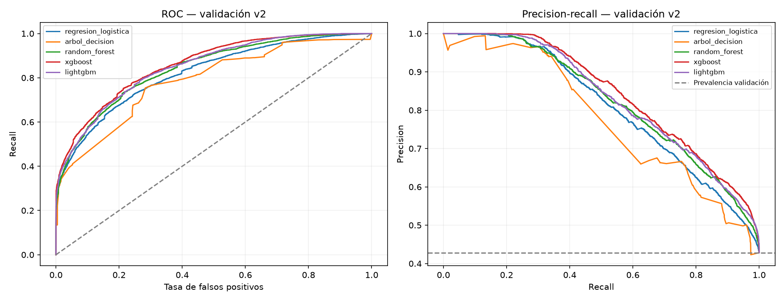
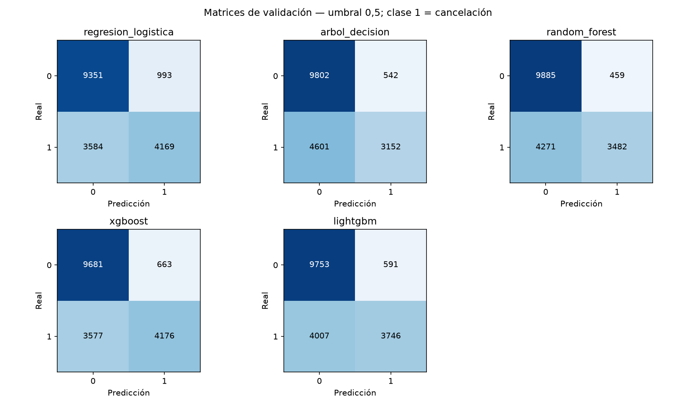
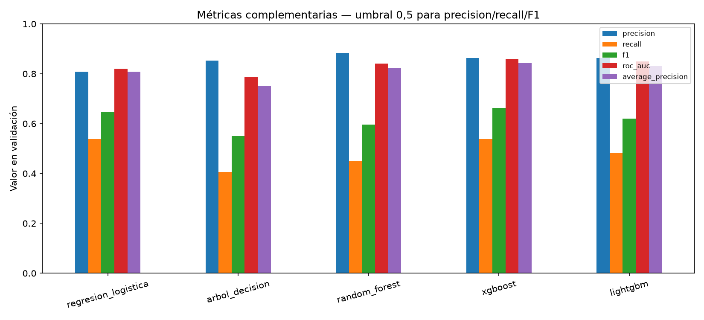

# Fase 5 — Comparación de modelos de clasificación

Fecha: 18/10/2026. Comparación académica exploratoria, exclusivamente validación v2. No se selecciona modelo definitivo ni umbral. Se revisaron fase 4.2, fase 4 histórica, splitting.py, baseline.py, preparación y las convenciones de los proyectos Python/Estadística del curso.

## 1. Protocolo y población

Se preservan los 119.390 registros y los 14 predictores. Se lee el manifiesto existente y se contrasta, sin escribirlo, contra la regla v2: alta aproximada = llegada − lead_time; disponibilidad aproximada = último estado + un día. Entrenamiento exige ambas fechas anteriores a 01/07/2016; validación, alta desde esa fecha y anterior a 01/01/2017, con disponibilidad anterior a este segundo corte. El cierre retrospectivo supuesto 01/12/2018 sigue intacto. No es un cierre PMS acreditado.

Entrenamiento: 54.164, de ellas 23.074 canceladas (42,60%). Validación: 18.097, de ellas 7.753 canceladas (42,84%). Las 20.564 pendientes y las 26.565 de prueba reservada no intervienen en ajuste, transformación, predicción o evaluación. Se cargan metadatos para verificar el manifiesto completo, y solo se devuelven train/validación a las funciones de modelos. Las métricas históricas v1 no participan en la comparación.

## 2. Pipelines y parámetros

Numéricas: lead_time, total_nights, adults, children, babies, children_missing. Categóricas: hotel, arrival_date_month, meal, country, market_segment, distribution_channel, reserved_room_type, customer_type. Objetivo is_canceled separado. Metadatos, estados finales y campos inciertos excluidos no entran en X.

Cada modelo crea un ColumnTransformer nuevo: imputación numérica por mediana, imputación categórica constante Desconocido, OneHotEncoder(handle_unknown='ignore', sparse_output=True), remainder='drop'. Solo logística añade StandardScaler. Los árboles no requieren escala. Una categoría desconocida queda a cero en su bloque; no se estima su efecto. Se verifican medianas, categorías y estadísticas de escalado contra train y su conservación al predecir validación. Representación one-hot común: 196 columnas; no se usa codificación nativa de categorías en boosting.

Configuraciones fijadas antes de evaluar, una por algoritmo, sin búsqueda, early stopping, calibración, remuestreo ni pesos de clase. Semilla 42, cuatro hilos en ensembles:

| Algoritmo | Parámetros iniciales explícitos |
| --- | --- |
| Logística | C=1, solver=lbfgs, max_iter=2000, class_weight=None; misma fábrica baseline v2 |
| Árbol | max_depth=8, min_samples_leaf=20; resto por defecto |
| Random Forest | n_estimators=200, min_samples_leaf=5, max_depth=None; resto por defecto |
| XGBoost | n_estimators=300, max_depth=4, learning_rate=0.05, subsample=0.8, colsample_bytree=0.8, tree_method=hist, objective=binary:logistic, eval_metric=logloss |
| LightGBM | n_estimators=300, num_leaves=31, learning_rate=0.05, min_child_samples=20, deterministic=True, force_col_wise=True, verbosity=-1 |

Árbol limitado para referencia interpretable; bosque con hojas mínimas para reducir fragmentación; boosting con tasa moderada y presupuesto fijo. No representan la capacidad óptima de cada familia. Todos los parámetros completos y versiones, incluidos defaults, constan en comparacion_5_verificacion.json. XGBoost 3.4.1 y LightGBM 4.7.0 se instalaron con wheels compatibles en el entorno local; la primera descarga requirió acceso de red fuera del sandbox. No fue necesario compilar.

## 3. Métricas en validación

Clase positiva 1 = cancelación. Umbral común 0,5, sin optimizar. La misma escala de salida probabilística permite comparar esa regla, pero no acredita calibración equivalente. Average Precision (AP) resume precision-recall sin integración trapezoidal; no se etiqueta como área trapezoidal PR-AUC. Referencia constante AP = prevalencia 0,428414; ROC-AUC = 0,5.

| modelo | accuracy | precision | recall | f1 | roc_auc | average_precision | tn | fp | fn | tp | fit_seconds | predict_seconds |
| --- | --- | --- | --- | --- | --- | --- | --- | --- | --- | --- | --- | --- |
| regresion_logistica | 0.747085 | 0.807633 | 0.537727 | 0.645606 | 0.820718 | 0.807536 | 9351 | 993 | 3584 | 4169 | 0.267440 | 0.018964 |
| arbol_decision | 0.715809 | 0.853276 | 0.406552 | 0.550712 | 0.786223 | 0.752406 | 9802 | 542 | 4601 | 3152 | 0.230861 | 0.017849 |
| random_forest | 0.738631 | 0.883532 | 0.449116 | 0.595519 | 0.841311 | 0.823312 | 9885 | 459 | 4271 | 3482 | 4.567623 | 0.082109 |
| xgboost | 0.765707 | 0.862988 | 0.538630 | 0.663278 | 0.858927 | 0.842275 | 9681 | 663 | 3577 | 4176 | 0.459084 | 0.038361 |
| lightgbm | 0.745925 | 0.863731 | 0.483168 | 0.619686 | 0.848655 | 0.830643 | 9753 | 591 | 4007 | 3746 | 0.381800 | 0.067237 |

TN/FP/FN/TP describen matrices [[TN, FP], [FN, TP]], con filas reales y columnas predichas, orden [0,1]. Tiempos en segundos, observados en este equipo; son mediciones orientativas, no un benchmark controlado. El trivial v2 ya documentado predice 0: accuracy 0,571586, precision/recall/F1 cero y matriz [[10344,0],[7753,0]]. La logística se reentrena y sus probabilidades coinciden con el baseline activo a tolerancia 1e-12.

## 4. Gráficos

Curvas comparan ordenación en todo el rango, sin seleccionar umbrales. Las matrices muestran la carga de alertas a 0,5. No se añaden gráficos redundantes de accuracy.

## 5. Interpretación y candidatos

XGBoost obtiene mayor ROC-AUC (0,8589), AP (0,8423), F1 (0,6633) y recall (0,5386). Frente a logística aumenta ROC-AUC en 0,0382 y AP en 0,0347; reduce falsos positivos de 993 a 663 (330 menos), con siete falsos negativos menos (3584 → 3577). La mejora de detección al umbral fijo es pequeña: aún omite el 46,14% de cancelaciones elegibles. Su precision aumenta de 80,76% a 86,30%. No basta para demostrar utilidad operacional.

LightGBM mejora discriminación respecto a logística (ROC-AUC 0,8487 y AP 0,8306) y reduce 402 falsas alarmas, pero pierde 423 detecciones: recall 48,32%. Su accuracy 74,59% es ligeramente inferior a logística pese a mayor AUC/AP: ordenación y decisión a umbral fijo son dimensiones distintas.

Random Forest alcanza la mayor precision (88,35%) y menos FP (459), a costa de recall 44,91% y 4271 FN; tarda más en este entorno. El árbol individual es más sencillo de inspeccionar, pero su recall 40,66%, ROC-AUC 0,7862 y AP 0,7524 quedan por debajo de logística. No se inicia explicabilidad. Logística conserva valor por sencillez, rapidez y mayor detección que árbol, bosque y LightGBM a 0,5, aunque su forma aditiva limita interacciones.

**Candidatos propuestos: XGBoost y LightGBM.** El primero ofrece el equilibrio más favorable observado de discriminación, precision, recall y errores, con coste acotado. El segundo aporta la siguiente mejor discriminación/AP y rapidez en esta configuración, con menor carga de falsas alertas que logística, pero menor recall. Ambos son menos transparentes que logística/árbol y requieren más control de complejidad; se mantiene logística como referencia obligatoria. No se declara superioridad estadística ni óptimo global. El bosque sería una alternativa si negocio priorizara pocas alertas; no se sustituye el criterio por accuracy.

FN significa no anticipar una cancelación y perder oportunidad de seguimiento o planificación; FP significa seguimiento innecesario y posible molestia para una reserva que se mantendría. Sin costes y acciones definidos no se calcula rentabilidad. AUC/AP no garantizan calibración ni efecto causal de intervenir.

## 6. Verificación, reproducibilidad y límites

El notebook se ejecuta completo con salidas y tres figuras. Las pruebas sintéticas comprueban exclusión de categorías exclusivas de validación, estadísticas de train, rechazo de solapamiento y reproducción de probabilidades con semillas para los cinco algoritmos. Se conservan hashes de todos los archivos preexistentes de datos/reportes e historia, y se comprueba su igualdad tras entrenar. No se serializan modelos ni se generan predicciones de prueba. Los resultados tabulares y probabilidades permiten recalcular todas las métricas. La reproducción íntegra se comprueba mediante una segunda ejecución con comparación de probabilidades; los tiempos pueden variar.

Persisten las limitaciones de 4.2: alta aproximada, última fecha de estado distinta de primera disponibilidad, cierre no acreditado y valores iniciales de los 14 predictores sin historial verificable. La selección de etiquetas disponibles favorece cancelaciones tempranas y menor antelación; no describe toda la cohorte. Duplicados conservados pueden sobreponderar patrones; no cruzan particiones exactas, pero faltan IDs reales. El EDA vio todo el archivo. Hay una sola validación temporal y escoger candidatos sobre ella introduce selección; no se presentan intervalos suponiendo independencia ni garantías de producción. Las configuraciones no están igualmente optimizadas, y diferencias pequeñas pueden variar con época o parámetros. No se acredita que estos cinco algoritmos estén todos cubiertos por materiales oficiales del curso, que no están aportados; se siguen los algoritmos pedidos y las convenciones de sus proyectos.

## 7. Archivos y siguiente fase propuesta

Nuevos: notebooks/comparacion_modelos.ipynb, src/comparison.py, tests/test_comparison.py, este informe, comparacion_5_metricas.csv, comparacion_5_predicciones_validacion.csv, comparacion_5_verificacion.json y tres PNG comparacion_5_* en reports/figures. Modificados: README, requirements.txt y src/run_notebook.py. Los artefactos del protocolo v2 permanecen intactos.

Para una fase 6 autorizada: definir costes/acciones con negocio y un presupuesto limitado de optimización de XGBoost/LightGBM; diseñar validación temporal interna respetando madurez y preprocesamiento por fold. Mantener logística como referencia, revisar calibración/umbral bajo un plan explícito y reservar prueba hasta congelar decisiones. Antes de cualquier pretensión de despliegue, obtener snapshots iniciales y seguimiento acreditado. No se ejecuta ninguna de esas tareas aquí.

**Fin de fase 5. Se espera revisión y autorización del usuario.**
