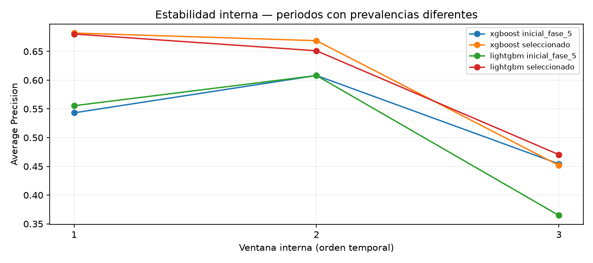
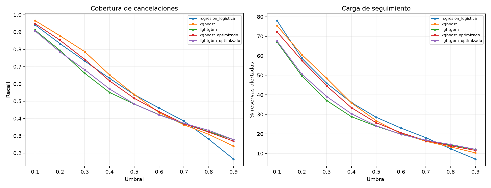
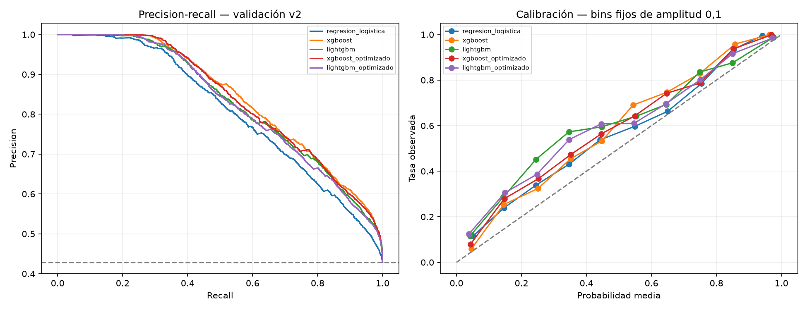

# Fase 6 — Optimización de modelos y análisis de umbrales

Fecha: 18/10/2026. Se completa exclusivamente fase 6, con protocolo **v2_estado_fechado_aproximado** intacto. Se recomienda **XGBoost inicial**, conservando la configuración de fase 5: la búsqueda mejora sus resultados internos, pero no mejora la evaluación externa. No se fija umbral operativo ni se acredita despliegue.

## 1. Revisión y contrato de datos

Se revisaron fase_4_2_protocolo_temporal.md, fase_5_comparacion_modelos.md, comparison.py, baseline.py, splitting.py, features.py y preprocessing.py, el manifiesto v2 y las convenciones de los proyectos Python y Estadística. Las métricas activas de fases 4.2 y 5 corresponden a v2; no se usan las métricas históricas v1. Se mantiene la organización de módulos, notebook narrado en español y reportes reproducibles del curso. No se dispone de materiales oficiales suficientes para acreditar el temario completo de optimización; RandomizedSearchCV sigue la técnica pedida.

Se mantienen 119.390 filas, 14 predictores, 54.164 filas de entrenamiento (23.074 canceladas, 42,60%) y 18.097 de validación externa (7.753 canceladas, 42,84%). Los cortes externos siguen siendo 01/07/2016 y 01/01/2017. Alta aproximada = llegada prevista − lead_time; disponibilidad aproximada = reservation_status_date + un día, con desigualdad estricta antes del corte. Cierre retrospectivo asumido 01/12/2018, sin cierre PMS acreditado. No se cambian madurez, IDs, limpieza ni listas de variables. Las 26.565 de prueba y 20.564 pendientes no se transforman, predicen ni evalúan. Leer fechas e IDs para contrastar el manifiesto no incorpora sus predictores a ajuste.

## 2. Validación temporal interna

Tres folds expansivos, fijados antes de comparar configuraciones y construidos exclusivamente dentro del entrenamiento externo. En cada fold: ajuste con alta y disponibilidad anteriores al inicio; validación con alta desde inicio hasta fin exclusivo y disponibilidad anterior a fin. Las filas con resultado posterior se purgan del rol correspondiente; no se desplazan a una validación anterior. Todas las fechas son proxies del mismo protocolo v2.

| fold | inicio_validacion | fin_exclusivo | n_train | n_validacion | tasa_train | tasa_validacion | max_disponibilidad_train | max_disponibilidad_val |
| --- | --- | --- | --- | --- | --- | --- | --- | --- |
| 0 | 2015-10-01 | 2016-01-01 | 13035 | 5799 | 0.510779 | 0.385066 | 2015-09-30 | 2015-12-31 |
| 1 | 2016-01-01 | 2016-04-01 | 25042 | 9795 | 0.464659 | 0.426953 | 2015-12-31 | 2016-03-31 |
| 2 | 2016-04-01 | 2016-07-01 | 39334 | 6277 | 0.466899 | 0.414529 | 2016-03-31 | 2016-06-30 |

Las validaciones internas no se solapan en altas/IDs y ningún grupo exacto cruza ajuste y validación de un fold. Los conjuntos de ajuste sí crecen y reutilizan observaciones de periodos anteriores: es lo previsto para una ventana expansiva. No se exige que las llegadas previstas no se superpongan: una cancelación ya registrada puede referirse a una llegada futura.

Las primeras ventanas no tienen un año completo de llegadas realizadas: el archivo empieza por llegadas en julio de 2015. Ver doce meses previstos en cancelaciones de largo plazo no equivale a historia anual observada. La alternativa conservadora adoptada es una búsqueda pequeña, referencias iniciales incluidas y ninguna afirmación de robustez entre años; una validación aleatoria ocultaría el cambio temporal. No se cambian ventanas tras observar sus resultados. Las filas apartadas de cada fold se cuentan en optimizacion_6_folds.csv respecto al universo ya elegible de entrenamiento externo; no son toda la censura del dataset original.

## 3. Búsqueda limitada y preprocesamiento

RandomizedSearchCV con ocho muestras sin reemplazo por algoritmo y una configuración inicial adicional: **nueve candidatos × tres folds × dos modelos = 54 ajustes internos**, más dos ajustes completos seleccionados. Seed 42, búsqueda secuencial (n_jobs=1), cuatro hilos por modelo, sin early stopping, refit=False. Criterio: media no ponderada de Average Precision de los tres periodos; desempate por ROC-AUC media y después índice del candidato. AP depende de prevalencia, por lo que se conservan tasas y resultados por periodo. ROC-AUC/AP se calculan con probabilidades, no con etiquetas a 0,5.

| Parámetro | XGBoost: valores muestreados | LightGBM: valores muestreados |
| --- | --- | --- |
| n_estimators | 200, 400 | 200, 400 |
| learning_rate | 0.03, 0.08 | 0.03, 0.08 |
| complejidad | max_depth: 3, 5 | num_leaves: 15, 31 |
| subsample | 0.8, 1.0 | 0.8, 1.0 |
| colsample_bytree | 0.8, 1.0 | 0.8, 1.0 |
| mínimo por hijo/hoja | min_child_weight: 1, 10 | min_child_samples: 20, 60 |
| reg_lambda | 1, 5 | 0, 5 |

Cada espacio tiene 128 combinaciones posibles; se muestrean ocho, no se recorre la cuadrícula. Los candidatos iniciales quedan fuera de esa cuadrícula cuando procede. LightGBM usa subsample_freq=1 en las ocho propuestas para activar submuestreo; la referencia conserva freq=0 y los parámetros de fase 5. XGBoost conserva tree_method=hist y objective=binary:logistic. No se añaden variables, algoritmos, balanceo ni pesos de clase.

Cada clon del pipeline aprende medianas numéricas y categorías exclusivamente de su subentrenamiento. Se imputa categoría constante Desconocido y se aplica OneHotEncoder(handle_unknown='ignore'); categorías nuevas quedan a cero en su bloque, sin aprender su efecto. No se escalan árboles. Logística conserva su pipeline escalado y sus predicciones congeladas v2 de fase 5. El scorer audita contra el subentrenamiento las medianas, categorías y lista de 14 entradas en **los 54 ajustes**. El ajuste completo usa las mismas auditorías de fit_one y comprueba que los parámetros de transformación no cambian al predecir validación. Ninguna fecha/ID/etiqueta entra en X.

| modelo | inicial_fase_5 | seleccionado | mean_ap | std_ap | mean_roc_auc | fold_0_ap | fold_1_ap | fold_2_ap |
| --- | --- | --- | --- | --- | --- | --- | --- | --- |
| xgboost | True | False | 0.535215 | 0.063027 | 0.571454 | 0.543154 | 0.608131 | 0.454361 |
| xgboost | False | True | 0.600819 | 0.105548 | 0.656801 | 0.682017 | 0.668691 | 0.451751 |
| lightgbm | True | False | 0.509424 | 0.104560 | 0.560118 | 0.555529 | 0.608046 | 0.364696 |
| lightgbm | False | True | 0.600621 | 0.092800 | 0.640552 | 0.680278 | 0.651117 | 0.470467 |

Mejores parámetros por validación interna:

| modelo | parametros |
| --- | --- |
| xgboost | {"classifier__subsample": 0.8, "classifier__reg_lambda": 1.0, "classifier__n_estimators": 200, "classifier__min_child_weight": 10, "classifier__max_depth": 5, "classifier__learning_rate": 0.08, "classifier__colsample_bytree": 0.8} |
| lightgbm | {"classifier__subsample_freq": 1, "classifier__subsample": 0.8, "classifier__reg_lambda": 0.0, "classifier__num_leaves": 15, "classifier__n_estimators": 400, "classifier__min_child_samples": 60, "classifier__learning_rate": 0.08, "classifier__colsample_bytree": 0.8} |

| modelo | ajustes_internos | segundos_busqueda |
| --- | --- | --- |
| xgboost | 27 | 5.593672 |
| lightgbm | 27 | 6.947389 |

Los parámetros completos, defaults y versiones se registran en optimizacion_6_verificacion.json. El default missing=NaN de XGBoost se representa como la cadena 'NaN' solo en ese registro JSON; la fábrica sigue utilizando el valor numérico original. El plan y la selección se escriben antes de predecir validación externa. No se seleccionan hiperparámetros con ella.

## 4. Evaluación externa de las dos selecciones

Una predicción externa nueva por configuración seleccionada, tras ajuste en las 54.164 filas permitidas. Para referencias se leen las probabilidades de fase 5 y se verifican sus métricas, sin volver a entrenarlas. Umbral inicial común **0,5**. 'Optimizado' significa seleccionado por búsqueda interna, no rendimiento mejor garantizado.

| modelo | accuracy | precision | recall | f1 | roc_auc | average_precision | tn | fp | fn | tp | fit_seconds | predict_seconds | origen |
| --- | --- | --- | --- | --- | --- | --- | --- | --- | --- | --- | --- | --- | --- |
| regresion_logistica | 0.747085 | 0.807633 | 0.537727 | 0.645606 | 0.820718 | 0.807536 | 9351 | 993 | 3584 | 4169 | 0.267440 | 0.018964 | fase_5_guardado |
| xgboost | 0.765707 | 0.862988 | 0.538630 | 0.663278 | 0.858927 | 0.842275 | 9681 | 663 | 3577 | 4176 | 0.459084 | 0.038361 | fase_5_guardado |
| lightgbm | 0.745925 | 0.863731 | 0.483168 | 0.619686 | 0.848655 | 0.830643 | 9753 | 591 | 4007 | 3746 | 0.381800 | 0.067237 | fase_5_guardado |
| xgboost_optimizado | 0.756811 | 0.859966 | 0.516445 | 0.645338 | 0.855129 | 0.838477 | 9692 | 652 | 3749 | 4004 | 0.298991 | 0.032654 | fase_6_seleccion_interna |
| lightgbm_optimizado | 0.744156 | 0.856588 | 0.483813 | 0.618365 | 0.843851 | 0.827120 | 9716 | 628 | 4002 | 3751 | 0.421834 | 0.065847 | fase_6_seleccion_interna |

Matrices [[TN, FP], [FN, TP]], filas reales y columnas predichas, orden [0,1]:

| modelo | matriz |
| --- | --- |
| regresion_logistica | [[9351, 993], [3584, 4169]] |
| xgboost | [[9681, 663], [3577, 4176]] |
| lightgbm | [[9753, 591], [4007, 3746]] |
| xgboost_optimizado | [[9692, 652], [3749, 4004]] |
| lightgbm_optimizado | [[9716, 628], [4002, 3751]] |

XGBoost seleccionado baja ROC-AUC de 0,858927 a 0,855129 y AP de 0,842275 a 0,838477. A 0,5 reduce 11 falsas alarmas, pero deja 172 cancelaciones adicionales sin detectar (FN 3577 → 3749). F1 cae de 0,663278 a 0,645338. No aporta mejora externa frente a su versión inicial.

LightGBM seleccionado baja ROC-AUC de 0,848655 a 0,843851 y AP de 0,830643 a 0,827120. Detecta cinco cancelaciones adicionales, pero genera 37 falsas alarmas más; F1 también desciende. Su Brier baja ligeramente, sin compensar la pérdida de discriminación ni acreditar utilidad mayor.

No se modifican espacios, ventanas o ensayos al observar esos resultados. Se conservan ambas configuraciones iniciales en lugar de sustituirlas por las seleccionadas internamente. Las diferencias son descriptivas: no se prueba significación ni generalización prospectiva. Tiempos de referencia proceden de fase 5 y los nuevos de fase 6, sin equivaler a benchmark controlado.

## 5. Estabilidad y límites de la optimización

Las AP internas medias suben de 0,5352 a 0,6008 en XGBoost y de 0,5094 a 0,6006 en LightGBM, pero varían mucho entre ventanas. Para XGBoost seleccionado, AP es 0,6820 / 0,6687 / 0,4518, y ROC-AUC 0,8154 / 0,6711 / 0,4839. LightGBM seleccionado termina con ROC-AUC 0,4678 en el tercer fold. **La discriminación cercana o inferior a 0,5 en esa ventana es una señal relevante de inestabilidad**, no un resultado que deba ocultarse con la media. La selección mejora las medias internas, sin resolver el cambio de población ni trasladarse a la externa.

También se exporta estabilidad externa por mes sin reajustar nada. XGBoost inicial tiene ROC-AUC mensual entre 0,7390 y 0,9665; AP entre 0,6513 y 0,9847. La prevalencia mensual pasa de aproximadamente 35–37% en julio-octubre a 53,47% en noviembre y 66,23% en diciembre. El filtro de disponibilidad al cierre favorece resultados tempranos cerca del corte; estos cambios no son evidencia de una mejora causal del modelo con el tiempo. La AP agregada no resume estabilidad operacional, ni permite comparar meses ignorando su composición.

## 6. Análisis de umbrales, solo validación

Rejilla prefijada 0,1 a 0,9, con predicción positiva si probabilidad >= umbral. No se busca un umbral definitivo por F1 o por costes hipotéticos. Tabla del candidato conservado, XGBoost inicial:

| modelo | umbral | precision | recall | f1 | fp | fn | alertas | porcentaje_alto_riesgo |
| --- | --- | --- | --- | --- | --- | --- | --- | --- |
| xgboost | 0.100000 | 0.548645 | 0.965949 | 0.699808 | 6161 | 264 | 13650 | 75.426866 |
| xgboost | 0.200000 | 0.620671 | 0.878370 | 0.727370 | 4162 | 943 | 10972 | 60.628834 |
| xgboost | 0.300000 | 0.694726 | 0.786663 | 0.737842 | 2680 | 1654 | 8779 | 48.510803 |
| xgboost | 0.400000 | 0.778959 | 0.652264 | 0.710004 | 1435 | 2696 | 6492 | 35.873349 |
| xgboost | 0.500000 | 0.862988 | 0.538630 | 0.663278 | 663 | 3577 | 4839 | 26.739239 |
| xgboost | 0.600000 | 0.918601 | 0.433768 | 0.589276 | 298 | 4390 | 3661 | 20.229872 |
| xgboost | 0.700000 | 0.961158 | 0.363859 | 0.527882 | 114 | 4932 | 2935 | 16.218158 |
| xgboost | 0.800000 | 0.989648 | 0.308268 | 0.470102 | 25 | 5363 | 2415 | 13.344753 |
| xgboost | 0.900000 | 0.998927 | 0.240165 | 0.387231 | 2 | 5891 | 1864 | 10.300050 |

Comparación de los cinco modelos a 0,3 / 0,5 / 0,7; los 45 casos completos están en optimizacion_6_umbrales.csv:

| modelo | umbral | precision | recall | f1 | fp | fn | alertas | porcentaje_alto_riesgo |
| --- | --- | --- | --- | --- | --- | --- | --- | --- |
| regresion_logistica | 0.300000 | 0.682048 | 0.732104 | 0.706190 | 2646 | 2077 | 8322 | 45.985522 |
| regresion_logistica | 0.500000 | 0.807633 | 0.537727 | 0.645606 | 993 | 3584 | 5162 | 28.524065 |
| regresion_logistica | 0.700000 | 0.911145 | 0.384883 | 0.541168 | 291 | 4769 | 3275 | 18.096922 |
| xgboost | 0.300000 | 0.694726 | 0.786663 | 0.737842 | 2680 | 1654 | 8779 | 48.510803 |
| xgboost | 0.500000 | 0.862988 | 0.538630 | 0.663278 | 663 | 3577 | 4839 | 26.739239 |
| xgboost | 0.700000 | 0.961158 | 0.363859 | 0.527882 | 114 | 4932 | 2935 | 16.218158 |
| lightgbm | 0.300000 | 0.763471 | 0.661550 | 0.708866 | 1589 | 2624 | 6718 | 37.122175 |
| lightgbm | 0.500000 | 0.863731 | 0.483168 | 0.619686 | 591 | 4007 | 4337 | 23.965298 |
| lightgbm | 0.700000 | 0.951244 | 0.369921 | 0.532689 | 147 | 4885 | 3015 | 16.660220 |
| xgboost_optimizado | 0.300000 | 0.711738 | 0.741390 | 0.726262 | 2328 | 2005 | 8076 | 44.626181 |
| xgboost_optimizado | 0.500000 | 0.859966 | 0.516445 | 0.645338 | 652 | 3749 | 4656 | 25.728021 |
| xgboost_optimizado | 0.700000 | 0.955696 | 0.370050 | 0.533519 | 133 | 4884 | 3002 | 16.588385 |
| lightgbm_optimizado | 0.300000 | 0.746083 | 0.681801 | 0.712495 | 1799 | 2467 | 7085 | 39.150135 |
| lightgbm_optimizado | 0.500000 | 0.856588 | 0.483813 | 0.618365 | 628 | 4002 | 4379 | 24.197381 |
| lightgbm_optimizado | 0.700000 | 0.949967 | 0.372243 | 0.534890 | 152 | 4867 | 3038 | 16.787313 |

Bajar XGBoost de 0,5 a 0,3 aumenta recall de 53,86% a 78,67%, pero reduce precision de 86,30% a 69,47% y eleva alertas de 4839 a 8779 (26,74% → 48,51%). Se evitarían 1923 FN en esta clasificación, a cambio de 2017 FP adicionales; no significa que un contacto evitase esas cancelaciones. A 0,7 precision alcanza 96,12%, pero solo se detecta 36,39% de cancelaciones. El umbral 0,3 ilustra un equilibrio, no una recomendación definitiva ni un máximo continuo certificado.

## 7. Calibración sin ajustar un calibrador

| modelo | brier | probabilidad_media | tasa_observada | brecha_media | ece_10_bins_descriptivo |
| --- | --- | --- | --- | --- | --- |
| regresion_logistica | 0.172022 | 0.355470 | 0.428414 | -0.072944 | 0.072944 |
| xgboost | 0.155458 | 0.356801 | 0.428414 | -0.071612 | 0.071612 |
| lightgbm | 0.171287 | 0.317930 | 0.428414 | -0.110483 | 0.110483 |
| xgboost_optimizado | 0.159277 | 0.346269 | 0.428414 | -0.082144 | 0.082144 |
| lightgbm_optimizado | 0.171001 | 0.322605 | 0.428414 | -0.105809 | 0.105809 |

Brier de referencia con probabilidad constante igual a la tasa de entrenamiento: 0.244881. Menor Brier es mejor, pero combina calibración, resolución y variabilidad del objetivo; no demuestra calibración por sí solo. ECE usa diez bins fijos y es descriptivo, sensible a la partición, no una garantía estadística. optimizacion_6_calibracion_bins.csv conserva tamaños y medias, sin dibujar bins vacíos.

Todos los modelos infrapredicen la cancelación en promedio. XGBoost inicial promedia 35,68% frente a 42,84% observado, brecha −7,16 puntos porcentuales. En su rango de 0,5 (incluido) a 0,6 (excluido), la probabilidad media es 54,34% frente a tasa 69,02% (1178 filas). Las curvas muestran desviaciones también en otros rangos. No cabe tratar esas salidas como probabilidades fiables de producción. XGBoost inicial tiene el menor Brier (0,155458), pero **no está suficientemente acreditada su calibración**. Logística tampoco queda calibrada por ser más sencilla; su Brier es 0,172022.

Ordenación (ROC-AUC/AP), probabilidad (Brier/curvas) y decisión de contactar son diferentes. No se ha calibrado con esta validación ni se ha ensayado un calibrador para conservar el que mejor salga aquí.

Para calibrar sin fuga haría falta prefijar un bloque temporal de calibración dentro del entrenamiento externo, con etiquetas disponibles al corte, entrenar el modelo base antes de ese bloque y congelarlo para producir los scores de calibración. Ni ese bloque ni un bloque posterior de evaluación se usarían para elegir hiperparámetros; alternativamente, generar scores temporales fuera de ajuste en un diseño anidado con purga por disponibilidad. Los folds internos ya usados para tuning no constituyen una calibración independiente por sí mismos. Tras ajustar el calibrador solo en el bloque permitido, evaluar una vez en un periodo posterior nuevo no utilizado. La validación actual ya explorada no puede recuperar independencia cambiándole el nombre; más historia y nuevos snapshots serían preferibles. Se explica el diseño, no se implementa en esta fase.

## 8. Escenarios de negocio hipotéticos

Contacto preventivo o solicitud de confirmación por personal del hotel, con capacidad y criterios de atención definidos. FP implica contacto innecesario, carga de trabajo y posible molestia; FN deja una cancelación sin anticipar y limita planificación. No se propone cancelar automáticamente, exigir penalizaciones ni cambiar derechos usando solo la predicción.

Los pesos siguientes son **supuestos ilustrativos en unidades arbitrarias por error**, no euros, no costes reales ni estimaciones de beneficio: FP/FN 1/1, 1/5 y 5/1. Carga = peso_FP × FP + peso_FN × FN. No incluye todos los costes de atención ni demuestra que intervenir reduzca la cancelación.

| umbral | coste_fp_supuesto | coste_fn_supuesto | carga_relativa_errores | carga_por_1000_reservas |
| --- | --- | --- | --- | --- |
| 0.200000 | 1 | 1 | 5105 | 282.090954 |
| 0.300000 | 1 | 1 | 4334 | 239.487208 |
| 0.500000 | 1 | 1 | 4240 | 234.292977 |
| 0.700000 | 1 | 1 | 5046 | 278.830745 |
| 0.200000 | 1 | 5 | 8877 | 490.523291 |
| 0.300000 | 1 | 5 | 10950 | 605.072664 |
| 0.500000 | 1 | 5 | 18548 | 1024.921258 |
| 0.700000 | 1 | 5 | 24774 | 1368.956181 |
| 0.200000 | 5 | 1 | 21753 | 1202.022435 |
| 0.300000 | 5 | 1 | 15054 | 831.850583 |
| 0.500000 | 5 | 1 | 6892 | 380.836603 |
| 0.700000 | 5 | 1 | 5502 | 304.028292 |

Por ejemplo, si FN pesara cinco veces FP, a 0,2 la carga ilustrativa sería 8877 frente a 18548 a 0,5. Si FP pesara cinco veces FN, sería 21753 frente a 6892. Cambiar supuestos cambia la preferencia; no se adopta ninguno como política real. Tampoco se transforma esa relación en una fórmula de umbral de probabilidad mientras la calibración sea incierta. La proporción alertada debe contrastarse con la capacidad de atención; la eficacia de contactar requeriría una evaluación de intervención separada.

## 9. Candidato principal para la siguiente fase

**XGBoost inicial de fase 5**, no la variante seleccionada por búsqueda: 300 árboles, profundidad máxima 4, learning_rate=0,05, subsample=0,8, colsample_bytree=0,8, min_child_weight=1 y reg_lambda=1 efectivos por defecto, tree_method=hist, seed 42, cuatro hilos. Se conserva la fábrica original; en su interfaz sklearn min_child_weight/reg_lambda pueden figurar None porque delegan al default del motor. No se cambia el umbral operativo.

Ofrece la mayor ROC-AUC y AP externa entre las cinco referencias, el mejor Brier observado, precision 86,30% y recall 53,86% a 0,5. Frente a logística reduce 330 FP y siete FN, con complejidad mayor pero entrenamiento local inferior a un segundo en esta configuración. La ganancia de detección a 0,5 es pequeña; la capacidad de ordenar mejor podría servir para seguimiento con recursos limitados, aún sin utilidad acreditada. Los ensembles son menos transparentes que logística y requieren una revisión posterior autorizada. Logística se conserva como referencia interpretable y rápida. LightGBM no ofrece una ventaja suficiente aquí.

La elección es **provisional para estudio**, no modelo listo para producción. Estabilidad interna deficiente, calibración sesgada y disponibilidad histórica incierta pesan más que una mejora decimal de AUC. Conservar la inicial sigue la instrucción de no sustituirla cuando la optimización no mejora.

## 10. Ejecución, archivos e integridad

Se crearon src/optimization.py, tests/test_optimization.py, notebooks/optimizacion.ipynb, este informe, registros optimizacion_6_* de plan, selección previa a evaluación, búsqueda completa, folds y sus IDs, métricas, predicciones externas, umbrales, bins/calibración, escenarios, estabilidad mensual y verificación, más tres PNG. Se actualizan README y src/run_notebook.py; no se necesitan nuevas dependencias.

La búsqueda real y los dos ajustes/predicciones externas terminaron. El primer intento de exportar la verificación final falló por el default NaN de XGBoost, después de guardar tablas, predicciones y figuras. Se corrigió su normalización JSON y se recuperó el registro desde esos artefactos y los parámetros seleccionados, sin repetir las predicciones externas. Los tiempos internos y selección proceden del archivo previo a evaluación; el registro de advertencias externas en memoria no se recuperó y se marca como desconocido, sin asumir que estuviera vacío. Las auditorías de ajuste sí habían finalizado. El notebook completo posterior verifica y presenta los resultados congelados sin errores ni nuevos ajustes, y conserva todas sus salidas.

Reejecutar el notebook detecta el registro final, verifica hashes/IDs, reconstruye folds y candidatos con la misma semilla, recalcula métricas, umbrales y calibración sobre scores guardados y regenera el informe. No ajusta de nuevo ni añade predicciones externas. Para reproducir la búsqueda desde cero se dispone del código y el plan; requeriría una copia de trabajo sin los artefactos fase 6, preservando la evidencia actual. No se elimina ningún registro para relanzar tuning tras ver validación. Reproducción de análisis no equivale a dos ejecuciones completas de búsqueda; solo hubo una búsqueda de 54 ajustes y dos predicciones externas nuevas. Los scores nuevos de XGBoost se restauran como float32 al leer su representación decimal CSV, para reproducir también Brier con precisión numérica. No se guardan modelos serializados ni predicciones de prueba.

Las 26 pruebas automatizadas del proyecto se superaron. Las pruebas sintéticas comprueban cortes estrictos, exclusión por disponibilidad, rechazo de filas externas y duplicados cruzados, ventanas no solapadas, semillas/espacios, umbrales, escenarios, bins y detección de un preprocesador ajustado indebidamente con datos futuros. Se conservan las pruebas anteriores. Se verifican también las huellas de los datos, manifiesto, informes e histórico, y los módulos del protocolo. El registro técnico incluye versiones y trazabilidad de la recuperación.

## 11. Limitaciones y propuesta posterior

No hay alta real ni primera disponibilidad de resultados acreditadas, snapshots iniciales de predictores ni cierre PMS demostrado. El filtro por resultados registrados conserva sesgo hacia menor antelación/cancelaciones tempranas y no representa todas las reservas. Duplicados conservados pueden sobreponderar patrones; no hay IDs reales de reserva/cliente. El EDA vio todo el archivo. La validación externa se ha utilizado para comparar en fase 5 y para revisar candidatos/umbrales/calibración aquí: no es una evaluación final independiente de selección. Ni la elección de modelo ni los umbrales explorados deben presentarse como validados en producción. No se calculan intervalos suponiendo independencia no acreditada. La búsqueda cubre ocho propuestas por familia, no todos los parámetros posibles, y las medias internas sobre periodos correlacionados no son una garantía de estabilidad.

Para la siguiente fase, tras autorización: revisar explicabilidad y errores del XGBoost inicial manteniendo logística como referencia, documentar disponibilidad real de variables y decidir un diseño temporal separado para calibración y decisión de contacto con costes/capacidad reales. No se ejecuta SHAP, no se preparan entregables finales ni se abre prueba. Una evaluación final solo tendrá sentido con decisiones congeladas y una declaración explícita de estas limitaciones; datos prospectivos serían necesarios para respaldar uso al crear reservas.

**Fin exclusivo de fase 6. Se espera revisión y autorización del usuario.**
