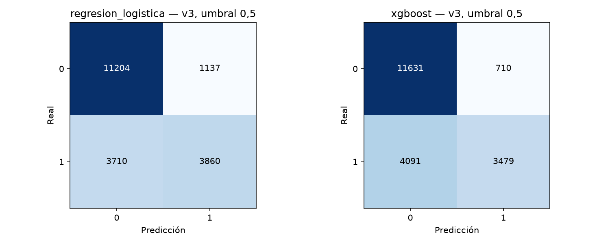
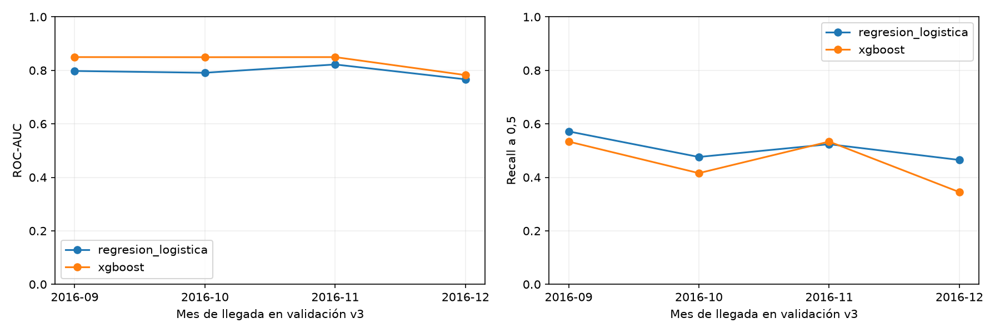

# Fase 7.1 — Corrección del sesgo de selección temporal

Fecha: 18/10/2026. **V3 sustituye v2 como protocolo activo.** Se selecciona la alternativa B, cohortes completas por llegada con seguimiento común por bloque y embargo. Es una evaluación retrospectiva exploratoria, no una simulación rigurosa de predicción al crear reservas. No se optimiza, calibra o fija umbral operativo y no se evalúa prueba.

## 1. Problema y causa de selección dependiente del resultado

Se revisaron fases 4.2, 5, 6 y 7, fuentes de división/preprocesamiento/entrenamiento y convenciones de notebooks. En v2, las altas aproximadas de validación están entre julio y diciembre de 2016, pero la llegada prevista puede situarse después. Exigir fecha de último estado + un día anterior a enero de 2017 permite incluir una cancelación anticipada para una llegada futura. Una estancia no cancelada que aún no ha ocurrido no puede satisfacer esa disponibilidad con un resultado final. El conjunto queda condicionado por el propio desenlace y el tiempo hasta observarlo.

El código no necesita consultar is_canceled para producir sesgo: fecha del resultado y cancelación están relacionadas. La regla es una selección informativa por disponibilidad, no una muestra neutral de todas las reservas del periodo. En el universo histórico de altas de validación v2 se incorporó 77,49% de cancelaciones frente a 62,44% de no cancelaciones:

| resultado | incluidas_v2 | apartadas_v2 | proporcion_incluida |
| --- | --- | --- | --- |
| canceladas | 7753 | 2252 | 0.774913 |
| no_canceladas | 10344 | 6223 | 0.624374 |

Las 3917 filas de validación v2 con llegada desde enero de 2017 están todas canceladas. Una reserva puede crearse antes del corte y cancelarse antes de llegar; eso justifica disponer de su etiqueta para aprender, pero no justifica una evaluación que incluye solo sus resultados tempranos y omite los negativos aún abiertos. Para XGBoost, 3166 de sus 4176 TP vienen de ese subgrupo. No se trata de corregir el algoritmo o de eliminar únicamente esos positivos para obtener un resultado preferido.

Diagnóstico usando exclusivamente las probabilidades y etiquetas de validación v2 ya congeladas, sin prueba histórica:

| grupo | modelo | n | canceladas | tasa_cancelacion | accuracy | precision | recall | f1 | roc_auc | average_precision |
| --- | --- | --- | --- | --- | --- | --- | --- | --- | --- | --- |
| validacion_v2_completa | regresion_logistica | 18097 | 7753 | 0.428414 | 0.747085 | 0.807633 | 0.537727 | 0.645606 | 0.820718 | 0.807536 |
| validacion_v2_completa | xgboost | 18097 | 7753 | 0.428414 | 0.765707 | 0.862988 | 0.538630 | 0.663278 | 0.858927 | 0.842275 |
| llegada_antes_2017 | regresion_logistica | 14180 | 3836 | 0.270522 | 0.735402 | 0.520290 | 0.280761 | 0.364714 | 0.709768 | 0.465509 |
| llegada_antes_2017 | xgboost | 14180 | 3836 | 0.270522 | 0.753949 | 0.603706 | 0.263295 | 0.366673 | 0.772138 | 0.538114 |
| llegada_desde_2017 | regresion_logistica | 3917 | 3917 | 1.000000 | 0.789380 | 1.000000 | 0.789380 | 0.882294 | No consultado/no estimable | 1.000000 |
| llegada_desde_2017 | xgboost | 3917 | 3917 | 1.000000 | 0.808272 | 1.000000 | 0.808272 | 0.893971 | No consultado/no estimable | 1.000000 |

La precision 1 y AP 1 en el subgrupo de una sola clase son efectos de su composición: no prueban discriminación, y ROC-AUC no se estima. La AP depende de prevalencia. En las 14180 con llegada anterior a 2017, XGBoost tiene precision 0,603706, recall 0,263295, ROC-AUC 0,772138 y AP 0,538114, frente a los indicadores agregados de la validación v2 seleccionada. No son nuevas alternativas de modelos ni una evaluación de prueba.

## 2. Cuatro fechas que no se confunden

| Fecha | Significado y uso |
| --- | --- |
| Alta aproximada | Llegada prevista menos lead_time. Proxy sin hora ni historial, conservado para auditoría. |
| Llegada prevista | Define el bloque v3; no se añade como nuevo predictor a X. El mes ya formaba parte de los 14 predictores. |
| Resultado fechado | reservation_status_date es último estado, no primera disponibilidad ni ingestión real. Solo se lee para auditar train/validación. |
| Cierre de seguimiento | Una fecha común prefijada por bloque, posterior a sus llegadas; no la fecha individual en que canceló cada reserva. |

Se conserva el objetivo is_canceled y los mismos 14 campos predictivos. Fecha final, IDs y metadatos no llegan a imputadores, codificadores o modelos. La evidencia previa de la fuente, resumida en fase 4.2, no acredita snapshots iniciales ni cierre PMS; esta limitación no se resuelve con v3.

## 3. Alternativas evaluadas antes de resultados v3

| Aspecto | A: cohortes por alta, seguimiento común | B: cohortes por llegada y embargo — seleccionada |
| --- | --- | --- |
| Población | Reservas creadas en determinados periodos, idealmente todas las altas del PMS. | Reservas registradas en la extracción para llegadas de bloques concretos. |
| Inclusión | Cohortes enteras con un horizonte/seguimiento completo prefijado, no filas porque cancelaron pronto. | Todas las filas con llegada en el bloque, sin filtrar por y o último estado. |
| Apartadas | Cohortes no observables hasta completar seguimiento; no solo negativos aún abiertos. | Meses de embargo y fechas fuera de cobertura; conservados en manifiesto. |
| Sesgo evitado | Rescatar resultados tempranos si la cohorte completa es observable. | Rescatar cancelaciones anticipadas con llegada posterior y excluir estancias aún abiertas. |
| Disponibilidad aquí | La extracción está delimitada por llegadas, no por altas; no acredita cohortes completas por creación. | Se ajusta al calendario de llegadas documentado y permite comprobar bloques observados con ambas clases. |
| Cronología | Un cierre común tardío no permite afirmar que el entrenamiento conocía todas sus etiquetas antes de las siguientes altas. | Se deja seguimiento del bloque previo antes del inicio de llegadas del siguiente, sin afirmar disponibilidad al alta. |
| Limitación restante | Faltan logs, cohortes completas, horizonte de negocio y versiones iniciales; un límite arbitrario de lead_time cambiaría la población. | Altas pueden solaparse; llegada y predictores pueden ser versiones actualizadas. No reproduce la decisión inicial. |
| Negocio | Sería la estrategia preferible para validar un sistema al reservar con datos prospectivos adecuados. | Sirve para estudiar generalización retrospectiva entre cohortes de llegada, con alcance académico reducido. |

Usar para A todos los resultados finales a cierre asumido de 2018 retiraría el filtro individual de madurez, pero no resolvería truncamiento por llegadas ni disponibilidad histórica para aprender antes de las altas evaluadas. A podría sostenerse con nuevos logs y seguimiento; no se selecciona aquí para afirmar una simulación al alta. B es más defendible para lo que este archivo realmente cubre, sin basarse en métricas mejores. La propuesta se guardó antes del manifiesto/modelos en protocolo_7_1_propuesta_previa.md; su hash queda en division_temporal.json. No se entrenó ningún modelo para escoger entre alternativas.

## 4. Reglas definitivas v3 y seguimiento comparable

Se mantiene un año completo de llegadas de entrenamiento y se fijan dos meses de calendario de embargo entre bloques. No se ajusta ese margen mirando métricas ni se presenta como una demora PMS universal:

- Entrenamiento: 2015-07-01 <= llegada < 2016-07-01. Cierre común exclusivo 2016-09-01.
- Embargo train/validación: 2016-07-01 <= llegada < 2016-09-01.
- Validación: 2016-09-01 <= llegada < 2017-01-01. Cierre común exclusivo 2017-03-01.
- Embargo validación/prueba: 2017-01-01 <= llegada < 2017-03-01.
- Prueba reservada: 2017-03-01 <= llegada < 2017-09-01. No se leen sus etiquetas, predicen ni evalúan modelos sobre ella.

La asignación solo usa fecha de llegada, unicidad y grupos técnicos para verificar cruces; es idéntica al cambiar etiquetas o fechas de estado. Esto es independencia funcional del criterio, no independencia estadística entre cohortes y cancelación. Las cohortes pueden tener prevalencias distintas por su composición.

Después de asignar y antes de entrenar, TODA la cohorte de entrenamiento/validación debe cumplir último estado + un día y salida prevista + un día anteriores a su cierre común. Si alguna fila falla se bloquea el bloque completo: no se elimina esa reserva ni se rescatan cancelaciones tempranas. No se usa esa condición para filtrar individualmente el manifiesto. La salida prevista se calcula con total_nights sin imputar etiquetas.

| particion | registros | cierre_comun_exclusivo | max_disponibilidad_proxy | max_salida_prevista | etiquetas_posteriores_cierre | salidas_posteriores_cierre | min_margen_dias_disponibilidad | disponibilidad_real_garantizada |
| --- | --- | --- | --- | --- | --- | --- | --- | --- |
| entrenamiento | 49157 | 2016-09-01 | 2016-07-20 | 2016-07-19 | 0 | 0 | 43 | False |
| validacion | 19911 | 2017-03-01 | 2017-01-15 | 2017-01-14 | 0 | 0 | 45 | False |

En entrenamiento, la última disponibilidad proxy es 20/07/2016, con 43 días hasta el cierre. En validación es 15/01/2017, con 45 días. Las últimas salidas previstas son 19/07/2016 y 14/01/2017. No quedan estados o salidas posteriores al cierre en ninguno de los dos bloques. Es seguimiento compatible con los registros disponibles, no prueba de que el PMS tuviese todos los resultados o actualizaciones en esas fechas. El cierre de prueba de 01/12/2018 conserva únicamente el supuesto retrospectivo previo y queda pendiente de auditoría autorizada; no se valida con sus etiquetas en esta fase.

## 5. Particiones, filas apartadas y antelación

| particion | n | canceladas | no_canceladas | tasa_cancelacion | lead_p10 | lead_mediana | lead_p90 | llegada_min | llegada_max | reserva_proxy_min | reserva_proxy_max |
| --- | --- | --- | --- | --- | --- | --- | --- | --- | --- | --- | --- |
| entrenamiento | 49157 | 17585.000000 | 31572.000000 | 0.357731 | 1.000000 | 56.000000 | 254.000000 | 2015-07-01 | 2016-06-30 | 2013-06-24 | 2016-06-30 |
| embargo_train_validacion | 9635 | No consultado/no estimable | No consultado/no estimable | No consultado/no estimable | 6.000000 | 117.000000 | 245.000000 | 2016-07-01 | 2016-08-31 | 2015-05-14 | 2016-08-31 |
| validacion | 19911 | 7570.000000 | 12341.000000 | 0.380192 | 4.000000 | 66.000000 | 313.000000 | 2016-09-01 | 2016-12-31 | 2015-02-20 | 2016-12-31 |
| embargo_validacion_prueba | 7858 | No consultado/no estimable | No consultado/no estimable | No consultado/no estimable | 1.000000 | 28.000000 | 134.000000 | 2017-01-01 | 2017-02-28 | 2015-07-10 | 2017-02-28 |
| prueba_reservada | 32829 | No consultado/no estimable | No consultado/no estimable | No consultado/no estimable | 6.000000 | 103.000000 | 264.000000 | 2017-03-01 | 2017-08-31 | 2015-07-10 | 2017-08-31 |
| fuera_cobertura | 0 | No consultado/no estimable | No consultado/no estimable | No consultado/no estimable | No consultado/no estimable | No consultado/no estimable | No consultado/no estimable | No consultado/no estimable | No consultado/no estimable | No consultado/no estimable | No consultado/no estimable |

Se conservan **119390 filas** en un solo manifiesto, sin solapamientos de IDs, grupos exactos ni ventanas de llegada. Se usan 69068 en entrenamiento/validación; 17493 quedan en embargos y 32829 en prueba. Nada se borra del CSV. Las clases de embargos/prueba se dejan sin consultar; una celda vacía no significa cero cancelaciones.

La mediana de antelación es 56 días en entrenamiento y 66 en validación; los percentiles 90 son 254 y 313. Los embargos tienen medianas 117 y 28; prueba, 103, solo como metadato. V3 conserva reservas de larga antelación dentro de cada cohorte elegida, sin imponer un máximo para cerrar resultados. No hace iguales las distribuciones ni elimina estacionalidad.

Las altas proxy reales se solapan entre roles: validación contiene reservas con alta aproximada desde febrero de 2015. Por ello no es una separación cronológica de altas ni una simulación de un modelo disponible cuando se crearon esas reservas. La coherencia adoptada es el orden de cohortes de llegada y el seguimiento del bloque previo antes del siguiente bloque; se declara el cambio de objetivo.

Transición de v2 a v3, solo por IDs y asignaciones:

| particion | embargo_train_validacion | embargo_validacion_prueba | entrenamiento | prueba_reservada | validacion |
| --- | --- | --- | --- | --- | --- |
| entrenamiento | 2281 | 181 | 48671 | 319 | 2712 |
| no_madura_entrenamiento | 5079 | 184 | 486 | 1382 | 4958 |
| no_madura_validacion | 0 | 2086 | 0 | 6053 | 336 |
| prueba_reservada | 0 | 4208 | 0 | 22357 | 0 |
| validacion | 2275 | 1199 | 0 | 2718 | 11905 |

## 6. Protección de prueba y exposición previa

Los 26565 IDs de prueba v1/v2 nunca pasan a desarrollo v3: 22357 quedan en prueba v3 y 4208 en el embargo enero-febrero. Se excluye incluso su lectura de etiquetas del nuevo ajuste y de la selección del protocolo. Solo se leen estados/objetivos nuevos para los 69068 IDs de entrenamiento/validación v3; el diagnóstico histórico aparte lee únicamente la validación v2 congelada, expresamente requerida para investigar el sesgo.

| destino_v3 | origen_v2 | n |
| --- | --- | --- |
| prueba_reservada | entrenamiento | 319 |
| prueba_reservada | no_madura_entrenamiento | 1382 |
| prueba_reservada | validacion | 2718 |
| prueba_reservada | no_madura_validacion | 6053 |
| prueba_reservada | prueba_reservada | 22357 |
| embargo_validacion_prueba | entrenamiento | 181 |
| embargo_validacion_prueba | no_madura_entrenamiento | 184 |
| embargo_validacion_prueba | validacion | 1199 |
| embargo_validacion_prueba | no_madura_validacion | 2086 |
| embargo_validacion_prueba | prueba_reservada | 4208 |

De los 32829 IDs de prueba v3, 319 estuvieron en entrenamiento v2 y 2718 en validación v2; otros 7435 proceden de sus grupos pendientes. Por tanto, redefinirla no restaura independencia: hay exposición previa de parte de sus casos a aprendizaje/análisis, además del EDA global. No se consultan nuevas etiquetas, predicciones o métricas de prueba para escoger v3. La composición por roles anteriores se obtiene solo del manifiesto. La futura evaluación sobre este bloque será exploratoria; una prueba prospectiva verdaderamente nueva requeriría más datos.

## 7. Logística y XGBoost iniciales, solo validación v3

Mismas fábricas, semillas y parámetros de fases anteriores. Logística: C=1, lbfgs, max_iter=2000, class_weight=None, random_state=42. XGBoost: 300 árboles, profundidad 4, tasa 0,05, subsample=0,8, colsample_bytree=0,8, hist, cuatro hilos, seed 42. No se usa la configuración optimizada de fase 6. Cada pipeline aprende medianas y vocabulario solo de las 49157 filas de entrenamiento; logística escala, árboles no. OneHotEncoder ignora desconocidas y la lista explícita excluye objetivo y metadatos. Umbral común diagnóstico 0,5; no se modifica para mejorar resultados.

| modelo | accuracy | precision | recall | f1 | roc_auc | average_precision | tn | fp | fn | tp | fit_seconds | predict_seconds |
| --- | --- | --- | --- | --- | --- | --- | --- | --- | --- | --- | --- | --- |
| regresion_logistica | 0.756567 | 0.772463 | 0.509908 | 0.614307 | 0.794590 | 0.762161 | 11204 | 1137 | 3710 | 3860 | 0.244782 | 0.021546 |
| xgboost | 0.758877 | 0.830508 | 0.459577 | 0.591717 | 0.830592 | 0.790062 | 11631 | 710 | 4091 | 3479 | 0.455004 | 0.037207 |

Matrices, filas reales y columnas predichas [0,1]:

| modelo | matriz |
| --- | --- |
| regresion_logistica | [[11204, 1137], [3710, 3860]] |
| xgboost | [[11631, 710], [4091, 3479]] |

En v3, XGBoost ofrece mayor ordenación (ROC-AUC 0,830592 y AP 0,790062 frente a 0,794590 y 0,762161), y mayor precision (83,05% frente a 77,25%). Sin embargo, detecta menos cancelaciones (recall 45,96% frente a 50,99%) y su F1 es inferior (0,591717 frente a 0,614307). Reduce 427 FP pero deja 381 FN adicionales. No se elige un modelo nuevo ni se cambia el umbral; estos son los dos modelos solicitados para revisar el protocolo. Los tiempos son orientativos del equipo, no un benchmark controlado.

**Las métricas v2 quedan históricas: no se restan de las v3 para atribuir una mejora/empeoramiento al algoritmo.** Cambian población, eje temporal, entrenamiento, composición y seguimiento. La comparación metodológica es que v2 condicionaba filas por resultado disponible; v3 utiliza cohortes enteras por llegada con embargos. No se afirma que v3 sea mejor porque su métrica sea mayor o menor.

## 8. Comprobación del sesgo y estabilidad restante

La validación v3 contiene cero llegadas desde enero de 2017: ya no se admiten cancelaciones anticipadas de una cohorte futura dentro del bloque evaluado. Incluye también todas las no cancelaciones de septiembre-diciembre que v2 podía apartar por disponibilidad, junto con las canceladas de esas mismas llegadas, sin selección individual por su fecha de resultado.

Antelación >180 días: **5742 filas, 3291 canceladas y 2451 no canceladas, tasa 57,31%**. Deja de ser el grupo artificialmente 100% positivo encontrado en v2. Todos los meses de validación v3 tienen ambas clases. Esto corrige el mecanismo concreto de rescate de cancelaciones futuras; no prueba que los datos sean libres de todo sesgo.

Train tiene tasa 35,77% y validación 38,02%, diferencia aproximada de 2,25 puntos porcentuales, sin ajustar prevalencias artificialmente. La tasa por mes de validación oscila de 36,22% a 40,53%; sigue habiendo composición y estacionalidad. No se calcula tasa de prueba en esta fase.

| modelo | dimension | grupo | n | canceladas | no_canceladas | tasa_cancelacion | suficiente_descriptivo | probabilidad_media | accuracy | precision | recall | f1 | roc_auc | average_precision |
| --- | --- | --- | --- | --- | --- | --- | --- | --- | --- | --- | --- | --- | --- | --- |
| regresion_logistica | hotel | City Hotel | 13690 | 5946 | 7744 | 0.434332 | True | 0.383323 | 0.731556 | 0.771067 | 0.543222 | 0.637395 | 0.805836 | 0.799854 |
| regresion_logistica | hotel | Resort Hotel | 6221 | 1624 | 4597 | 0.261051 | True | 0.215831 | 0.811606 | 0.779703 | 0.387931 | 0.518092 | 0.723919 | 0.602743 |
| regresion_logistica | mes_llegada | 2016-09 | 5394 | 2022 | 3372 | 0.374861 | True | 0.373821 | 0.757508 | 0.723404 | 0.571711 | 0.638674 | 0.797730 | 0.773074 |
| regresion_logistica | mes_llegada | 2016-10 | 6203 | 2514 | 3689 | 0.405288 | True | 0.313588 | 0.756892 | 0.862392 | 0.476134 | 0.613532 | 0.791028 | 0.777722 |
| regresion_logistica | mes_llegada | 2016-11 | 4454 | 1636 | 2818 | 0.367310 | True | 0.308466 | 0.775932 | 0.796468 | 0.523839 | 0.632006 | 0.822028 | 0.785417 |
| regresion_logistica | mes_llegada | 2016-12 | 3860 | 1398 | 2462 | 0.362176 | True | 0.325102 | 0.732383 | 0.695187 | 0.464950 | 0.557222 | 0.766532 | 0.697721 |
| regresion_logistica | antelacion_grupo | 0-7 | 2886 | 282 | 2604 | 0.097713 | True | 0.171281 | 0.856202 | 0.175610 | 0.127660 | 0.147844 | 0.641644 | 0.159353 |
| regresion_logistica | antelacion_grupo | 181+ | 5742 | 3291 | 2451 | 0.573145 | True | 0.615603 | 0.825845 | 0.844926 | 0.852628 | 0.848760 | 0.904439 | 0.938027 |
| regresion_logistica | antelacion_grupo | 31-90 | 5093 | 1801 | 3292 | 0.353623 | True | 0.210367 | 0.684076 | 0.679104 | 0.202110 | 0.311510 | 0.728048 | 0.587844 |
| regresion_logistica | antelacion_grupo | 8-30 | 3331 | 872 | 2459 | 0.261783 | True | 0.178840 | 0.752327 | 0.579125 | 0.197248 | 0.294269 | 0.700280 | 0.479543 |
| regresion_logistica | antelacion_grupo | 91-180 | 2859 | 1324 | 1535 | 0.463099 | True | 0.312752 | 0.650927 | 0.755486 | 0.364048 | 0.491335 | 0.714506 | 0.684446 |
| xgboost | hotel | City Hotel | 13690 | 5946 | 7744 | 0.434332 | True | 0.355579 | 0.734259 | 0.855077 | 0.467373 | 0.604393 | 0.838959 | 0.822459 |
| xgboost | hotel | Resort Hotel | 6221 | 1624 | 4597 | 0.261051 | True | 0.188958 | 0.813053 | 0.745474 | 0.431034 | 0.546235 | 0.771974 | 0.651947 |
| xgboost | mes_llegada | 2016-09 | 5394 | 2022 | 3372 | 0.374861 | True | 0.341252 | 0.781795 | 0.821782 | 0.533630 | 0.647076 | 0.849660 | 0.812898 |
| xgboost | mes_llegada | 2016-10 | 6203 | 2514 | 3689 | 0.405288 | True | 0.261186 | 0.747703 | 0.915863 | 0.415672 | 0.571819 | 0.849268 | 0.827080 |
| xgboost | mes_llegada | 2016-11 | 4454 | 1636 | 2818 | 0.367310 | True | 0.327764 | 0.782443 | 0.809082 | 0.533619 | 0.643094 | 0.849595 | 0.810634 |
| xgboost | mes_llegada | 2016-12 | 3860 | 1398 | 2462 | 0.362176 | True | 0.290850 | 0.717617 | 0.734756 | 0.344778 | 0.469328 | 0.782378 | 0.697300 |
| xgboost | antelacion_grupo | 0-7 | 2886 | 282 | 2604 | 0.097713 | True | 0.090881 | 0.902633 | 0.600000 | 0.010638 | 0.020906 | 0.688924 | 0.220011 |
| xgboost | antelacion_grupo | 181+ | 5742 | 3291 | 2451 | 0.573145 | True | 0.519425 | 0.831940 | 0.911245 | 0.783045 | 0.842294 | 0.927311 | 0.950402 |
| xgboost | antelacion_grupo | 31-90 | 5093 | 1801 | 3292 | 0.353623 | True | 0.249368 | 0.674651 | 0.609091 | 0.223209 | 0.326696 | 0.745316 | 0.592296 |
| xgboost | antelacion_grupo | 8-30 | 3331 | 872 | 2459 | 0.261783 | True | 0.229032 | 0.759231 | 0.648305 | 0.175459 | 0.276173 | 0.723764 | 0.502038 |
| xgboost | antelacion_grupo | 91-180 | 2859 | 1324 | 1535 | 0.463099 | True | 0.267796 | 0.616649 | 0.747826 | 0.259819 | 0.385650 | 0.724736 | 0.692250 |

XGBoost tiene ROC-AUC mensual alrededor de 0,849 en septiembre-noviembre y 0,782 en diciembre; el recall varía de 34,48% a 53,36%. Por hotel, AUC 0,839 en City y 0,772 en Resort; recall 46,74% y 43,10%, respectivamente. Logística ofrece más recall en City (54,32%) y menos en Resort (38,79%). Las diferencias son descriptivas y no acreditan superioridad estable o significación; se conservan tamaños/clases y se marcan segmentos con n<100 o menos de 30 de alguna clase. Con una clase no se estima AUC; AP 0/1 sería degenerada por composición.

En 0–7 días, XGBoost apenas detecta 3 de 282 cancelaciones (recall 1,06%) a 0,5, aunque su accuracy 90,26% parezca alta. La corrección de cohorte no elimina dificultades del algoritmo ni convierte el umbral en una política adecuada. No se inicia otro análisis de umbrales, calibración u optimización.

## 9. Trazabilidad, ejecución y verificaciones

V1 permanece intacto. V2 se congela antes de la modificación en reports/historico/protocolo_v2, con 139 archivos de informes, fuentes, pruebas, notebooks, README y dependencias, más registro de hashes. Los informes raíz de fases anteriores conservan sus resultados históricos. Se sustituyen únicamente los nombres activos de manifiesto, división, baseline, predicciones/verificación baseline y estado. Los nuevos resultados de ambos modelos se guardan con prefijo protocolo_7_1_ y versión explícita.

splitting.py conserva las funciones históricas v1/v2 y añade temporal_split_v3, PROTOCOL_V3 y auditoría por bloque. temporal_split sin sufijo sigue siendo v2 para compatibilidad histórica; la entrada vigente src/temporal_bias_v3.py llama explícitamente temporal_split_v3. Las cargas/ejecuciones históricas v2 sobre el workspace activo v3 se bloquean para evitar sobrescritura o comparar manifiestos diferentes. Para reproducir v2 se requiere copia aislada del árbol archivado, junto con los CSV originales verificados; no se edita el histórico congelado.

Se crea notebooks/correccion_sesgo_temporal.ipynb y tests/test_temporal_bias_v3.py; se actualizan README y ejecutor, sin nuevas dependencias. Las pruebas comprueban fronteras y embargos, asignación ajena a etiqueta/estado, rechazo de fechas/duplicados, seguimiento tardío que bloquea cohorte completa, prohibición de auditar resultados de prueba, lectura selectiva de etiquetas y protección de entradas v2. Se conservan pruebas anteriores. El notebook se ejecuta completo y el registro recoge integridad, fit solo train, manifestación previa a métricas y ausencia de predicciones de prueba. La reproducción usa las mismas reglas/semillas y contrasta scores; no hay búsqueda de alternativas por métricas.

## 10. Limitaciones y recomendación

1. **Ninguna alternativa permite garantizar una simulación temporal rigurosa al alta con este archivo.** V3 define una evaluación retrospectiva por llegada que sí elimina la selección individual por resultados tempranos, pero cambia el problema temporal evaluado.
2. La extracción sigue seleccionada por llegadas, sin altas completas, logs de valores iniciales o IDs reales de reserva/cliente. Las fechas pueden reflejar planes actualizados. No se introducen fechas finales en X, pero tampoco se acredita que los 14 valores sean iniciales.
3. Último estado + un día es un proxy, no ingestión/primera disponibilidad garantizada. La coherencia de fechas observadas y los márgenes no prueban que falten cero resultados. El cierre de prueba de 2018 sigue sin acreditar.
4. Los embargos excluyen llegadas de verano y enero-febrero de desarrollo actual: las métricas describen septiembre-diciembre, no el año completo ni todas las altas. Un entrenamiento de doce meses no equivale a varias réplicas anuales de validación.
5. Duplicados conservados y grupos comerciales pueden sobreponderar patrones. El EDA y la comparación anterior vieron datos que ahora son validación/prueba ampliada. Las conclusiones y la futura prueba son exploratorias, no una evaluación totalmente independiente.
6. Se conserva la representación CSR y sus ceros implícitos del modelo inicial, explicada en fase 7. No se cambia ahora limpieza/representación para alterar resultados. No se recalibran ni optimizan modelos bajo v3; los rankings SHAP y umbrales de v2 quedan históricos, no se transfieren como decisiones v3.

Antes de continuar: revisar y aceptar el alcance retrospectivo v3 y sus embargos; mantener ambos modelos de referencia y decidir, en fase posterior autorizada, si se necesita nueva validación temporal de calibración/modelo y datos prospectivos con snapshots. No reutilizar hiperparámetros, umbral o calibración elegidos en v2 como si estuvieran validados en v3. Para una evaluación final, congelar previamente todas las decisiones y declarar exposición del bloque reservado; para validar uso al alta hará falta un dataset adicional adecuado. No se evalúa prueba, preparan entregables finales ni se avanza de fase.

**Fin exclusivo de fase 7.1. Se espera revisión y autorización del usuario.**
