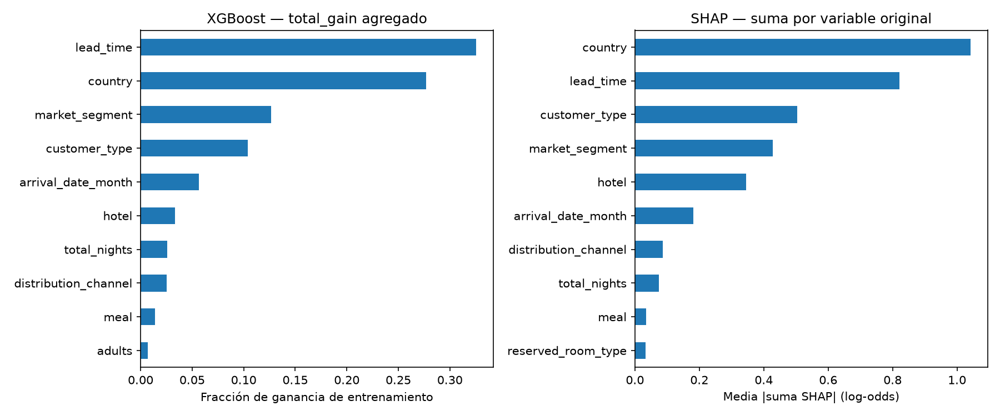
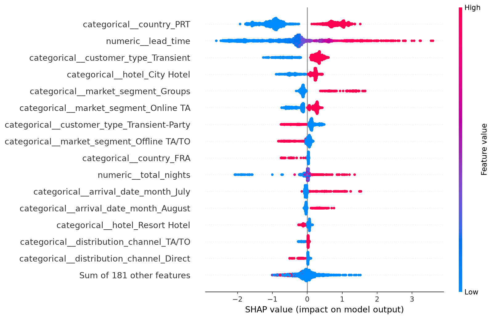
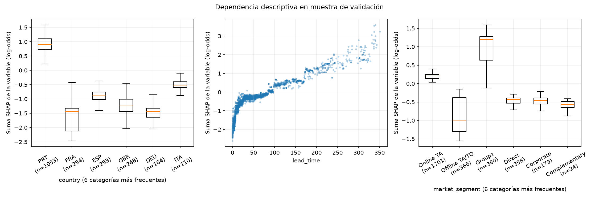
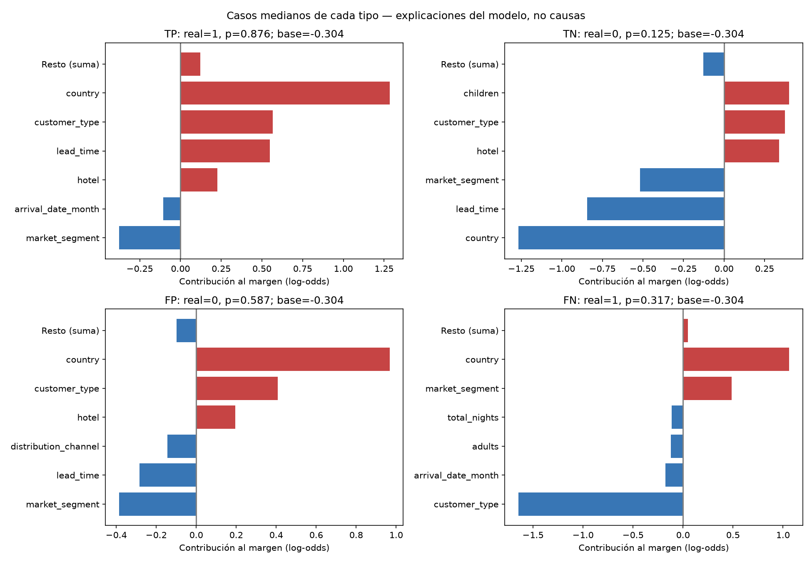
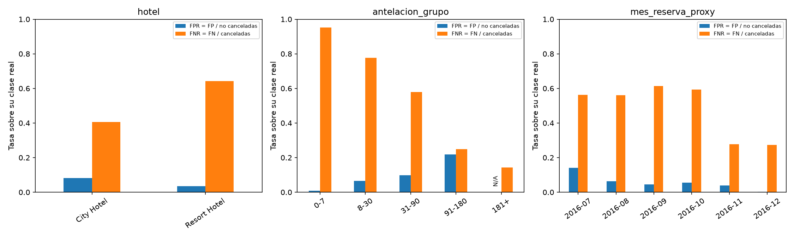
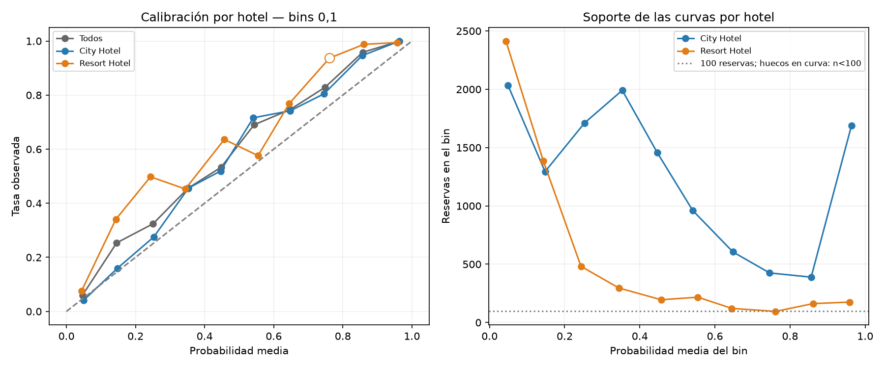

# Fase 7 — Explicabilidad y análisis de errores del modelo

Fecha: 18/10/2026. Se analiza exclusivamente **XGBoost inicial de fase 5**, conservado tras fase 6. No se optimiza, cambia protocolo/predictores, ajusta calibrador, elige umbral operativo ni evalúa prueba. El candidato sigue siendo provisional. La interpretación es del modelo y de la validación elegible, no de causas de cancelación ni del conjunto completo de altas.

## 1. Modelo, revisión y reproducibilidad

Se revisaron los informes de fases 5 y 6, el protocolo temporal v2, comparison.py, optimization.py, baseline.py, splitting.py, features.py, preprocessing.py y las convenciones narrativas de los notebooks del proyecto y proyectos anteriores del curso. Se conserva la organización data/notebooks/src/reports.

300 árboles, max_depth=4, learning_rate=0.05, subsample=0.8, colsample_bytree=0.8, tree_method=hist, objective=binary:logistic, eval_metric=logloss, n_jobs=4, random_state=42. La fábrica original mantiene defaults: no se sustituye por el modelo de 200 árboles de la búsqueda. Se contrastan todos los parámetros contra el registro de fase 5. Como no había modelo serializado, se reconstruye con las mismas 54.164 filas de entrenamiento; imputación por mediana, ausencia categórica Desconocido y OneHotEncoder(handle_unknown='ignore'), sin escalado. Medianas/categorías y conservación de estadísticas se auditan con fit_one. Las predicciones coinciden con las congeladas en fase 5 dentro de precisión float32 y producen idéntica matriz [[9681,663],[3577,4176]]. No se consultan predictores o resultados de prueba para explicar, comparar o decidir.

Validación externa: 18.097 filas, tasa observada 42,84%; umbral **0,5 exclusivamente diagnóstico**, accuracy 0,765707, precision 0,862988, recall 0,538630, F1 0,663278, ROC-AUC 0,858927 y AP 0,842275. El diagnóstico completo de errores/calibración utiliza las probabilidades ya guardadas; el modelo reconstruido sirve para importancia y SHAP. No hay actualización del modelo definitivo.

## 2. Importancia del modelo

Se utiliza **total_gain**, suma de la reducción del objetivo en los splits de entrenamiento de cada columna. Se normaliza y se suman las columnas derivadas por variable original; no se confunde esa suma con el promedio gain. La definición se contrasta en la [API oficial de XGBoost](https://xgboost.readthedocs.io/en/stable/python/python_api.html#xgboost.Booster.get_score). Las columnas sin splits tienen importancia cero.

| original | total_gain | proporcion_gain |
| --- | --- | --- |
| lead_time | 106256.609375 | 0.325697 |
| country | 90385.657458 | 0.277050 |
| market_segment | 41262.507441 | 0.126478 |
| customer_type | 33874.959908 | 0.103833 |
| arrival_date_month | 18469.764183 | 0.056613 |
| hotel | 10819.005005 | 0.033162 |
| total_nights | 8370.643555 | 0.025658 |
| distribution_channel | 8259.481354 | 0.025317 |
| meal | 4627.532166 | 0.014184 |
| adults | 2234.437744 | 0.006849 |
| children | 807.191833 | 0.002474 |
| reserved_room_type | 735.906080 | 0.002256 |
| babies | 139.763000 | 0.000428 |
| children_missing | 0.000000 | 0.000000 |

Antelación representa 32,57% de ganancia, país 27,71%, segmento de mercado 12,65% y tipo de cliente 10,38%. Esta medida depende de splits, cardinalidad, interacciones y variables correlacionadas; no mide mejora causal, efecto de cambiar un dato ni importancia fuera de muestra. Una variable con muchas categorías dispone de más oportunidades de partición; la agregación facilita leerla pero no elimina ese sesgo. children_missing no interviene en splits; su cero no demuestra irrelevancia universal de la información ausente.

## 3. SHAP global y correspondencia de características

Compatibilidad comprobada con SHAP 0.54.1 y XGBoost 3.4.1, tanto en prueba sintética como en el modelo real.

TreeExplainer, tree_path_dependent, model_output=raw y cálculo exacto (no Saabas). El fondo se obtiene de las rutas del entrenamiento almacenadas en los árboles, sin elegir datos de prueba o un fondo de validación. La salida explicada es el margen log-odds: **base + suma SHAP = margen; sigmoide(margen) = probabilidad**. No son puntos porcentuales. Esta semántica y las comprobaciones de aditividad están documentadas en [SHAP TreeExplainer](https://shap.readthedocs.io/en/latest/generated/shap.TreeExplainer.html).

Los 14 predictores se convierten en 196 columnas. Su correspondencia se construye a partir del orden numérico y las categorías del encoder, sin partir nombres por guiones bajos. Se conserva la matriz CSR durante predicción y SHAP; densificarla introduciría ceros explícitos donde el árbol trata entradas dispersas como ausentes y podría cambiar la función explicada. La [FAQ oficial de XGBoost](https://xgboost.readthedocs.io/en/stable/faq.html#why-do-i-see-different-results-with-sparse-and-dense-data) aclara esa diferencia. Solo se densifica una copia para colorear el resumen, nunca para calcular atribuciones. La semántica heredada de ceros implícitos también puede afectar ceros numéricos reales; se mantiene para explicar el modelo existente y queda como aspecto de representación a revisar antes de uso operacional, sin cambiarlo en esta fase.

Muestra global: **3000 de 18.097** filas, aleatoria simple sin reemplazo, generador NumPy seed 42, sin condicionar a etiqueta o error. Se incluyen ambos hoteles y los seis meses proxy. Hay 2072 City y 928 Resort; cancelación de la muestra 41,27% frente a 42,84% poblacional. Se exporta el perfil completo y los IDs técnicos: la muestra se aproxima a la composición de validación, sin representatividad certificada de todas las reservas. Cuatro ejemplos medianos por tipo de error se explican en la misma unión si faltaban, pero no se agregan a la media global.

Error máximo de reconstrucción del margen: 0.00000453; de probabilidad: 0.000000477. El cálculo SHAP tardó 0.188 segundos en este equipo; no es un benchmark.

Se suman contribuciones **con signo por fila** de todas las dummies de cada variable y después se calcula media absoluta (mean_abs_group_sum). También se publica la suma de medias absolutas por dummy, generalmente mayor porque no cancela signos. La suma conserva el margen local; no recalcula el juego Shapley considerando cada variable original como un jugador único ni resuelve dependencia entre dummies.

| original | mean_abs_group_sum | mean_signed_group_sum | sum_mean_abs_dummies |
| --- | --- | --- | --- |
| country | 1.042501 | -0.405589 | 1.248223 |
| lead_time | 0.820577 | -0.436659 | 0.820578 |
| customer_type | 0.503253 | 0.285152 | 0.504941 |
| market_segment | 0.427576 | 0.011401 | 0.611474 |
| hotel | 0.344652 | 0.016697 | 0.344820 |
| arrival_date_month | 0.181617 | -0.040635 | 0.268933 |
| distribution_channel | 0.085927 | -0.010606 | 0.110424 |
| total_nights | 0.073706 | -0.014041 | 0.073706 |
| meal | 0.034761 | -0.007540 | 0.051876 |
| reserved_room_type | 0.033207 | 0.003865 | 0.039972 |
| children | 0.027978 | 0.003153 | 0.027978 |
| adults | 0.025129 | -0.000965 | 0.025129 |
| babies | 0.004300 | 0.000619 | 0.004300 |
| children_missing | 0.000000 | 0.000000 | 0.000000 |

País es primero en media absoluta agrupada (1,043 log-odds), seguido de antelación (0,821), tipo de cliente (0,503), segmento (0,428) y hotel (0,345). El cambio de orden frente a total_gain es coherente con medidas distintas: estructura del entrenamiento frente a contribuciones sobre esta muestra. El signo medio no describe una relación monótona ni un efecto de intervención. Una dummy con cero puede contribuir: también se explica ausencia de esa categoría/ruta, no solo categorías activas.

## 4. Dependencias y riesgo estimado

Los gráficos muestran antelación y las variables relevantes disponibles, con dispersión numérica o cajas de categorías más frecuentes. Son valores observados y contribuciones, sin variar artificialmente una categoría manteniendo combinaciones imposibles. Las cajas no son intervalos de confianza. El perfil de categorías y antelación de la muestra se guarda en explicabilidad_7_dependencia_perfil.csv.

| variable | valor_grupo | n_muestra | shap_medio_log_odds | probabilidad_media | tasa_cancelacion |
| --- | --- | --- | --- | --- | --- |
| country | PRT | 1053 | 0.900238 | 0.505243 | 0.552707 |
| country | ESP | 293 | -0.933095 | 0.213230 | 0.320819 |
| country | BRA | 107 | -0.766811 | 0.369503 | 0.383178 |
| country | GBR | 248 | -1.257877 | 0.249395 | 0.342742 |
| country | DEU | 164 | -1.515429 | 0.227361 | 0.323171 |
| country | FRA | 294 | -1.617460 | 0.172346 | 0.190476 |
| country | ITA | 110 | -0.525170 | 0.438476 | 0.554545 |
| market_segment | Corporate | 179 | -0.473555 | 0.209458 | 0.234637 |
| market_segment | Direct | 358 | -0.463090 | 0.130795 | 0.187151 |
| market_segment | Online TA | 1701 | 0.160669 | 0.353927 | 0.426220 |
| market_segment | Offline TA/TO | 366 | -0.871960 | 0.236453 | 0.297814 |
| market_segment | Groups | 360 | 0.965745 | 0.727117 | 0.805556 |
| customer_type | Transient | 2645 | 0.447110 | 0.368333 | 0.426087 |
| customer_type | Transient-Party | 342 | -0.944072 | 0.188403 | 0.321637 |
| hotel | Resort Hotel | 928 | -0.530100 | 0.206135 | 0.300647 |
| hotel | City Hotel | 2072 | 0.261594 | 0.410169 | 0.462838 |
| lead_time | 0-7 | 682 | -1.792840 | 0.111167 | 0.101173 |
| lead_time | 8-30 | 700 | -0.614049 | 0.270182 | 0.275714 |
| lead_time | 31-90 | 998 | -0.228646 | 0.354476 | 0.439880 |
| lead_time | 91-180 | 376 | 0.492610 | 0.623289 | 0.779255 |
| lead_time | 181+ | 244 | 1.580090 | 0.770890 | 1.000000 |

Antelación, país, tipo de cliente y mercado participan conjuntamente; no hay una regla universal de riesgo basada en uno de ellos. En esta validación, Groups tiene probabilidad media 73,01% frente a 13,08% en Direct; 91–180 días, 63,50%, frente a 11,21% en 0–7 días. Son asociaciones del score con segmentos condicionados por elegibilidad, no efectos causales de reservar antes o usar un canal. Que país tenga importancia alta puede reflejar mezcla comercial/geográfica, selección y relaciones con otras variables; no autoriza decisiones de trato adverso por origen.

## 5. Cuatro explicaciones individuales

Se elige la reserva con probabilidad mediana dentro de TP/TN/FP/FN, orden estable para desempatar. No se buscan casos extremos favorables. Los cuatro ejemplos resultan de City Hotel y no representan todos los perfiles ni errores de Resort. Las referencias exportadas son IDs técnicos de fila, no IDs personales; el informe omite esos números y el valor de país. No se publican nombres/contactos, agente o empresa.

| caso | real | probabilidad | base_log_odds | margen | margen_reconstruido | hotel | lead_time | market_segment | distribution_channel | arrival_date_month |
| --- | --- | --- | --- | --- | --- | --- | --- | --- | --- | --- |
| TP | 1 | 0.876274 | -0.304050 | 1.957605 | 1.957605 | City Hotel | 169.000000 | Offline TA/TO | TA/TO | June |
| TN | 0 | 0.125048 | -0.304050 | -1.945468 | -1.945468 | City Hotel | 14.000000 | Direct | Direct | August |
| FP | 0 | 0.587126 | -0.304050 | 0.352097 | 0.352097 | City Hotel | 31.000000 | Corporate | Corporate | November |
| FN | 1 | 0.317130 | -0.304050 | -0.766995 | -0.766994 | City Hotel | 95.000000 | Groups | TA/TO | November |

Contribuciones agrupadas principales, en log-odds; valores positivos aumentan el margen respecto a la base y negativos lo reducen:

| caso | variable | valor | shap_log_odds |
| --- | --- | --- | --- |
| TP | country | categoría omitida en ejemplo local | 1.284220 |
| TP | customer_type | Transient | 0.565508 |
| TP | lead_time | 169.0 | 0.549369 |
| TP | market_segment | Offline TA/TO | -0.377824 |
| TP | hotel | City Hotel | 0.225422 |
| TN | country | categoría omitida en ejemplo local | -1.268013 |
| TN | lead_time | 14.0 | -0.844953 |
| TN | market_segment | Direct | -0.518143 |
| TN | children | 2.0 | 0.401117 |
| TN | customer_type | Transient | 0.375585 |
| FP | country | categoría omitida en ejemplo local | 0.967460 |
| FP | customer_type | Transient | 0.407941 |
| FP | market_segment | Corporate | -0.386701 |
| FP | lead_time | 31.0 | -0.283995 |
| FP | hotel | City Hotel | 0.195046 |
| FN | customer_type | Transient-Party | -1.646770 |
| FN | country | categoría omitida en ejemplo local | 1.060616 |
| FN | market_segment | Groups | 0.484481 |
| FN | arrival_date_month | November | -0.175541 |
| FN | adults | 1.0 | -0.119959 |

- **TP, p≈0,876:** antelación 169 días y tipo Transient empujan al alza (+0,549 y +0,566); la contribución agrupada de país suma +1,284. Offline TA/TO compensa parcialmente (−0,378). Realmente canceló; no se afirma que esas variables lo causaran.
- **TN, p≈0,125:** antelación de 14 días (−0,845), mercado Direct (−0,518) y contribución de país (−1,268) reducen el margen. Otros factores suben, pero la suma queda por debajo del corte; la reserva se mantuvo.
- **FP, p≈0,587:** país (+0,967), Transient (+0,408) y City (+0,195) superan parcialmente aportes negativos de Corporate (−0,387) y antelación de 31 días (−0,284). El modelo alertaría sobre una reserva que no canceló: SHAP explica el score equivocado, no demuestra un problema real del huésped.
- **FN, p≈0,317:** Transient-Party aporta −1,647 y domina pese a país (+1,061) y Groups (+0,484). La reserva sí canceló, pero quedó sin alerta. Esto ilustra una combinación que el modelo infravalora; no demuestra que el tipo de cliente explique todos los FN.

La base común es −0,30405 log-odds, no la tasa media de validación. La probabilidad se obtiene después de sumar todas las contribuciones; sumar probabilidades individuales de las barras sería incorrecto. El gráfico muestra seis aportes principales y resto agregado para mantener la suma.

## 6. Errores por segmentos y sus denominadores

Se analiza validación completa. FPR = FP / no canceladas; FNR = FN / canceladas; tasa de error = (FP+FN)/n. Los tamaños, cantidades por clase, precision, recall, F1, AUC, probabilidad media y prevalencia se exportan para todas las dimensiones solicitadas. Un grupo se marca suficiente solo para descripción si n>=100 y cada clase tiene al menos 30 casos: es una regla de prudencia, no una prueba estadística. Con una clase, ROC-AUC no se estima. Los grupos pequeños quedan visibles y señalados, sin ranking concluyente.

| dimension | grupo | n | canceladas | fp | fn | fpr | fnr | suficiente_descriptivo |
| --- | --- | --- | --- | --- | --- | --- | --- | --- |
| hotel | City Hotel | 12556 | 5960 | 534 | 2425 | 0.080958 | 0.406879 | True |
| hotel | Resort Hotel | 5541 | 1793 | 129 | 1152 | 0.034418 | 0.642499 | True |
| antelacion_grupo | 0-7 | 3922 | 390 | 29 | 371 | 0.008211 | 0.951282 | True |
| antelacion_grupo | 181+ | 1540 | 1540 | 0 | 221 | No estimable | 0.143506 | False |
| antelacion_grupo | 31-90 | 6058 | 2742 | 322 | 1586 | 0.097105 | 0.578410 | True |
| antelacion_grupo | 8-30 | 4167 | 1198 | 197 | 930 | 0.066352 | 0.776294 | True |
| antelacion_grupo | 91-180 | 2410 | 1883 | 115 | 469 | 0.218216 | 0.249071 | True |
| market_segment | Aviation | 63 | 14 | 1 | 14 | 0.020408 | 1.000000 | False |
| market_segment | Complementary | 174 | 25 | 5 | 21 | 0.033557 | 0.840000 | False |
| market_segment | Corporate | 1010 | 201 | 22 | 87 | 0.027194 | 0.432836 | True |
| market_segment | Direct | 2025 | 354 | 15 | 314 | 0.008977 | 0.887006 | True |
| market_segment | Groups | 2255 | 1840 | 11 | 237 | 0.026506 | 0.128804 | True |
| market_segment | Offline TA/TO | 2129 | 671 | 67 | 239 | 0.045953 | 0.356185 | True |
| market_segment | Online TA | 10441 | 4648 | 542 | 2665 | 0.093561 | 0.573365 | True |
| distribution_channel | Corporate | 1279 | 310 | 22 | 141 | 0.022704 | 0.454839 | True |
| distribution_channel | Direct | 2367 | 515 | 23 | 357 | 0.012419 | 0.693204 | True |
| distribution_channel | GDS | 72 | 20 | 0 | 17 | 0.000000 | 0.850000 | False |
| distribution_channel | TA/TO | 14379 | 6908 | 618 | 3062 | 0.082720 | 0.443254 | True |

City acumula más errores por su volumen: 534 FP y 2425 FN, frente a 129 y 1152 en Resort. Sin embargo, Resort omite 64,25% de sus cancelaciones frente a 40,69% en City. La tasa global de error parece similar (23,12% y 23,57%), pero oculta coberturas de cancelación diferentes.

Online TA concentra 542 FP y 2665 FN; dentro de sus 10441 filas, FPR=9,36% y FNR=57,34%. Direct tiene solo 15 FP, pero omite 314 de 354 cancelaciones (FNR=88,70%): pocas falsas alarmas no equivalen a buena detección. Los canales son otra clasificación de las mismas reservas: TA/TO tiene 618 FP y 3062 FN, sin poder sumarlos a los de Online TA. Entre 31–90 días se acumulan 1586 FN, FNR=57,84%, con n=6058. Con 0–7 días hay 371 FN de 390 cancelaciones (95,13%), aunque el error sobre todas las reservas es solo 10,20% por su baja prevalencia. No se cambia umbral para corregir estos resultados.

**Señal metodológica esencial:** las 1540 reservas elegibles con antelación >180 días son todas canceladas. Los meses de llegada enero-junio también tienen una sola clase en validación. Son grupos con suficiente volumen pero sin contraste de clases; no se declara ROC-AUC ni evidencia de detección de no cancelaciones. La llegada posterior al cierre proxy y la exigencia de resultado antes de 2017 favorecen cancelaciones ya registradas frente a estancias que aún no han ocurrido. Se audita llegada respecto al corte solo como metadato, nunca como predictor nuevo:

| grupo | n | canceladas | no_canceladas | tasa_cancelacion | roc_auc |
| --- | --- | --- | --- | --- | --- |
| Antes de 2017-01-01 | 14180 | 3836 | 10344 | 0.270522 | 0.772138 |
| Desde 2017-01-01 | 3917 | 3917 | 0 | 1.000000 | No estimable |

De las 3917 reservas con llegada desde 2017-01-01, todas están canceladas y 3166 son TP: aproximadamente 75,8% de los TP totales procede de este subgrupo de una sola clase. En las 14180 con llegada anterior al corte, la tasa observada es 27,05%, ROC-AUC 0,7721, precision 60,37% y recall 26,33%. Esta descomposición es una auditoría de la misma validación, no una nueva partición para seleccionar modelo. Evidencia cuánto condiciona el resultado agregado la elegibilidad por fecha de estado.

No significa que en negocio todas las reservas largas o para esos meses cancelen. Parte de la facilidad del modelo para ordenar puede proceder de esa selección temporal. La interpretación del calendario y antelación debe declarar este sesgo; no se relajan cortes ni se incorporan etiquetas futuras para mejorar métricas.

## 7. Estabilidad temporal y meses de llegada

| grupo | n | tasa_cancelacion | probabilidad_media | roc_auc | precision | recall | f1 |
| --- | --- | --- | --- | --- | --- | --- | --- |
| 2016-07 | 2925 | 0.365470 | 0.363802 | 0.739036 | 0.640604 | 0.436857 | 0.519466 |
| 2016-08 | 3245 | 0.374114 | 0.319670 | 0.809017 | 0.805136 | 0.439044 | 0.568230 |
| 2016-09 | 3656 | 0.365427 | 0.281728 | 0.841204 | 0.829582 | 0.386228 | 0.527068 |
| 2016-10 | 3018 | 0.348575 | 0.277806 | 0.828056 | 0.797020 | 0.406844 | 0.538704 |
| 2016-11 | 3112 | 0.534704 | 0.453107 | 0.935160 | 0.956245 | 0.722356 | 0.823006 |
| 2016-12 | 2141 | 0.662307 | 0.503082 | 0.966481 | 0.998062 | 0.726375 | 0.840816 |

Julio proxy tiene AUC 0,7390 y precision 64,06%; diciembre, AUC 0,9665 y precision 99,81%. El recall aumenta de 43,69% a 72,64%, pero la prevalencia también cambia de 36,55% a 66,23% y cambia el mecanismo de selección cerca del corte. No se interpreta como mejora temporal del sistema. Los meses se evalúan en las mismas reservas de validación que ya se han utilizado para seleccionar/comparar; no son un nuevo holdout independiente.

Meses de llegada (distintos del mes proxy de reserva):

| grupo | n | tasa_cancelacion | probabilidad_media | roc_auc | precision | recall | f1 | suficiente_descriptivo |
| --- | --- | --- | --- | --- | --- | --- | --- | --- |
| April | 627 | 1.000000 | 0.806220 | No estimable | 1.000000 | 0.883573 | 0.938188 | False |
| August | 1717 | 0.278393 | 0.285808 | 0.785503 | 0.692029 | 0.399582 | 0.506631 | True |
| December | 2815 | 0.316519 | 0.279537 | 0.786374 | 0.630832 | 0.349046 | 0.449422 | True |
| February | 363 | 1.000000 | 0.674492 | No estimable | 1.000000 | 0.691460 | 0.817590 | False |
| January | 836 | 1.000000 | 0.595953 | No estimable | 1.000000 | 0.667464 | 0.800574 | False |
| July | 1007 | 0.435948 | 0.488836 | 0.908886 | 0.821429 | 0.838269 | 0.829763 | True |
| June | 519 | 1.000000 | 0.771881 | No estimable | 1.000000 | 0.799615 | 0.888651 | False |
| March | 377 | 1.000000 | 0.766515 | No estimable | 1.000000 | 0.856764 | 0.922857 | False |
| May | 746 | 1.000000 | 0.789825 | No estimable | 1.000000 | 0.836461 | 0.910949 | False |
| November | 3459 | 0.248916 | 0.232412 | 0.791867 | 0.623955 | 0.260163 | 0.367213 | True |
| October | 3256 | 0.295455 | 0.226711 | 0.800986 | 0.694158 | 0.209979 | 0.322426 | True |
| September | 2375 | 0.275368 | 0.260090 | 0.747867 | 0.627530 | 0.237003 | 0.344062 | True |

Octubre tiene recall 21,00% (760 FN), noviembre 26,02% (637 FN). Enero-junio carecen de negativos por elegibilidad, por lo que su aparente precision 100% no acredita desempeño completo. Las comparaciones son marginales, sin controlar simultáneamente país, mercado, hotel y fechas, y se realizan varias inspecciones; diferencias pequeñas no son hallazgos concluyentes. Duplicados y agrupaciones comerciales reducen el tamaño efectivo; no se inventan intervalos de confianza asumiendo independencia.

## 8. Calibración por intervalos y hotel

Global: Brier **0,155458**; probabilidad media 35,68% frente a 42,84% observado, infrapredicción de 7,16 puntos porcentuales. Brier combina resolución y calibración, no las separa. Por hotel:

| grupo | n | probabilidad_media | tasa_cancelacion | brecha_calibracion | brier |
| --- | --- | --- | --- | --- | --- |
| City Hotel | 12556 | 0.419491 | 0.474673 | -0.055183 | 0.152778 |
| Resort Hotel | 5541 | 0.214746 | 0.323588 | -0.108841 | 0.161531 |

Resort infrapredice 10,88 puntos frente a 5,52 en City; ambos tienen miles de filas. La comparación debe considerar sus distintas composiciones y prevalencias. No se propone un calibrador por hotel a partir de este mismo diagnóstico. Los intervalos fijos de 0,1 conservan tamaños; los menores de 100 se señalan y no se interpretan con el mismo peso. El último intervalo incluye probabilidad 1.

| hotel | bin | inferior | superior | n | probabilidad_media | tasa_observada | n_al_menos_100 |
| --- | --- | --- | --- | --- | --- | --- | --- |
| Todos | 0 | 0.000000 | 0.100000 | 4447 | 0.046201 | 0.059366 | True |
| Todos | 1 | 0.100000 | 0.200000 | 2678 | 0.145464 | 0.253547 | True |
| Todos | 2 | 0.200000 | 0.300000 | 2193 | 0.250804 | 0.324213 | True |
| Todos | 3 | 0.300000 | 0.400000 | 2287 | 0.352126 | 0.455619 | True |
| Todos | 4 | 0.400000 | 0.500000 | 1653 | 0.447514 | 0.532970 | True |
| Todos | 5 | 0.500000 | 0.600000 | 1178 | 0.543352 | 0.690153 | True |
| Todos | 6 | 0.600000 | 0.700000 | 726 | 0.647464 | 0.746556 | True |
| Todos | 7 | 0.700000 | 0.800000 | 520 | 0.748561 | 0.828846 | True |
| Todos | 8 | 0.800000 | 0.900000 | 551 | 0.857616 | 0.958258 | True |
| Todos | 9 | 0.900000 | 1.000000 | 1864 | 0.963000 | 0.998927 | True |
| City Hotel | 0 | 0.000000 | 0.100000 | 2033 | 0.049192 | 0.040334 | True |
| City Hotel | 1 | 0.100000 | 0.200000 | 1294 | 0.147797 | 0.159969 | True |
| City Hotel | 2 | 0.200000 | 0.300000 | 1711 | 0.252898 | 0.275278 | True |
| City Hotel | 3 | 0.300000 | 0.400000 | 1991 | 0.353316 | 0.456052 | True |
| City Hotel | 4 | 0.400000 | 0.500000 | 1458 | 0.446234 | 0.519204 | True |
| City Hotel | 5 | 0.500000 | 0.600000 | 961 | 0.540808 | 0.715921 | True |
| City Hotel | 6 | 0.600000 | 0.700000 | 605 | 0.647968 | 0.742149 | True |
| City Hotel | 7 | 0.700000 | 0.800000 | 425 | 0.745665 | 0.804706 | True |
| City Hotel | 8 | 0.800000 | 0.900000 | 389 | 0.856163 | 0.946015 | True |
| City Hotel | 9 | 0.900000 | 1.000000 | 1689 | 0.963532 | 0.999408 | True |
| Resort Hotel | 0 | 0.000000 | 0.100000 | 2414 | 0.043683 | 0.075394 | True |
| Resort Hotel | 1 | 0.100000 | 0.200000 | 1384 | 0.143282 | 0.341040 | True |
| Resort Hotel | 2 | 0.200000 | 0.300000 | 482 | 0.243373 | 0.497925 | True |
| Resort Hotel | 3 | 0.300000 | 0.400000 | 296 | 0.344121 | 0.452703 | True |
| Resort Hotel | 4 | 0.400000 | 0.500000 | 195 | 0.457085 | 0.635897 | True |
| Resort Hotel | 5 | 0.500000 | 0.600000 | 217 | 0.554615 | 0.576037 | True |
| Resort Hotel | 6 | 0.600000 | 0.700000 | 121 | 0.644947 | 0.768595 | True |
| Resort Hotel | 7 | 0.700000 | 0.800000 | 95 | 0.761517 | 0.936842 | False |
| Resort Hotel | 8 | 0.800000 | 0.900000 | 162 | 0.861104 | 0.987654 | True |
| Resort Hotel | 9 | 0.900000 | 1.000000 | 175 | 0.957866 | 0.994286 | True |

No se ha ajustado ningún calibrador. Para una fase posterior, diseñar antes de mirar resultados un bloque temporal de calibración dentro del entrenamiento, distinto de selección de hiperparámetros y con resultados disponibles al corte; entrenar el modelo base solo antes del bloque, congelarlo y obtener scores fuera de ajuste. Ajustar calibración en ese bloque y evaluarla una vez en un periodo posterior no utilizado para decidir. Alternativa: diseño temporal anidado de scores fuera de ajuste, con purga de etiquetas tardías. Los folds de fase 6, ya usados para tuning, no son automáticamente independientes para calibrar y evaluar. La validación externa actual ya ha sido explorada; no recupera independencia por cambiarle el nombre. Más historia, snapshots iniciales y seguimiento acreditado son preferibles para un nuevo diseño. No se emplea prueba para aprender calibración ni se inicia ese trabajo aquí.

## 9. Lectura para revenue management

El modelo combina sobre todo país, antelación, tipo de cliente y mercado; puede ayudar a ordenar una lista de seguimiento, pero la cifra de probabilidad no es una frecuencia de negocio acreditada. Groups y antelaciones largas reciben puntuaciones elevadas en esta población seleccionada; Direct, estancias cercanas y varias combinaciones de cliente/canal plantean cancelaciones difíciles de detectar. Online TA concentra la mayor carga de errores por mercado y merece revisar datos/proceso, sin confundir volumen con peor tasa universal.

Podrían evaluarse contactos preventivos, recordatorios o solicitudes de confirmación con supervisión humana, capacidad y efectos medidos. No se recomienda cancelar, penalizar ni alterar condiciones automáticamente por el score o por país. Una alerta no prueba intención de cancelar; un FN no demuestra ausencia de señales humanas. Las atribuciones ayudan a auditar la función, pero no acreditan qué acción evitaría una cancelación. Faltan costes y eficacia causal de intervenciones para establecer rentabilidad.

## 10. Ejecución, archivos y limitaciones

Nuevos: src/explainability.py, tests/test_explainability.py, notebooks/explicabilidad.ipynb, este informe, tablas explicabilidad_7_* (mapeo, gain, SHAP global/transformado, muestra/perfil/IDs, contribuciones locales, segmentos, bins, dependencias y scores) y explicabilidad_7_shap.npz con valores y base. Se generan seis figuras PNG. Modificados: README, requirements.txt (SHAP 0.54.1) y src/run_notebook.py. Las dependencias previas se conservan; SHAP usa wheels compatibles, sin compilar. La primera descarga sin acceso de red falló; la instalación autorizada sí terminó.

Se ejecuta el notebook completo con salidas, pruebas automatizadas y comprobaciones de scores/aditividad y huellas. La prueba de compatibilidad sintética usa CSR con ceros y reconstruye margen y probabilidad. Se verifican mapeo one-hot, suma agrupada, denominadores de segmentos con una clase, bins y selección reproducible de ejemplos. La ejecución de pruebas en sandbox encontró una restricción sobre el temporal de una prueba anterior; fuera del sandbox se superan. El registro final conserva tamaños, versiones, tiempos, errores numéricos y hashes de datos, particiones, informes, módulos y notebooks previos. No se guardan nombres ni datos personales de clientes; país agregado es una variable predictiva, no identificación individual. No se evalúa prueba.

Persisten: alta y disponibilidad aproximadas, cierre PMS no acreditado, predictores sin versiones iniciales verificadas, censura/selección por resultados registrados, duplicados conservados, relaciones entre variables y mezcla comercial no controladas. El EDA vio todo el archivo y la validación se ha reutilizado en fases anteriores. SHAP depende de la función y de su referencia/path-dependence; variables correlacionadas pueden repartirse atribución de forma no única y la agrupación de dummies no convierte las atribuciones en efectos originales causales. El ranking se calcula en una muestra de validación, no toda la demanda. Su composición puede cambiar en otro periodo. Aditividad correcta no valida disponibilidad de datos, causalidad, calibración ni producción.

## 11. Recomendación antes de evaluación final

Mantener XGBoost inicial como candidato provisional y logística como referencia, sin presentar explicabilidad como autorización de despliegue. Revisar primero los segmentos de una sola clase, el papel de calendario/antelación y la semántica de ceros dispersos; para contrastes adicionales se necesita un protocolo separado autorizado, no modificar retrospectivamente v2. Obtener evidencia de variables iniciales y seguimiento real. Diseñar calibración temporal independiente y política de contacto con costes/capacidad reales; congelar modelo, transformación, calibración y umbral antes de una evaluación final autorizada. Prueba permanece cerrada y sus resultados no se usan para ninguna de estas decisiones. Con los datos actuales, una evaluación final seguirá requiriendo declarar todas las limitaciones; para afirmar utilidad operacional se necesitaría validación prospectiva y evaluación de intervención.

**Fin exclusivo de fase 7. Se espera revisión y autorización del usuario.**
