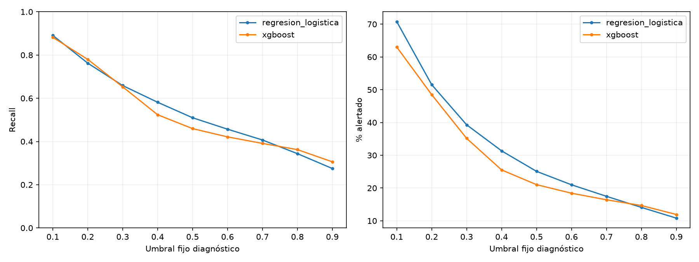
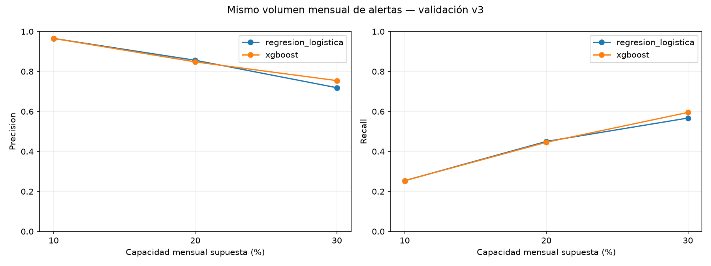
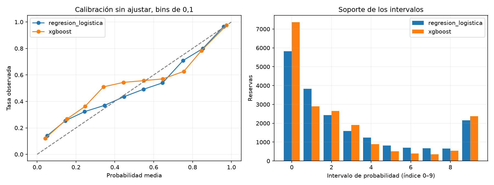

# Fase 8 — Selección final del modelo y política de decisión

Fecha: 18/10/2026. **Selección congelada: regresión logística inicial + prioridad del 20% por mes de llegada**, ambos hoteles juntos. El 20% es un supuesto académico de capacidad fijado antes de comparar capacidades, no un recurso real del hotel ni una política rentable demostrada. Prueba sigue sin predecir ni evaluar. No se modifican v3, predictores, hiperparámetros o calibración.

## 1. Protocolo y artefactos vigentes

Se revisan fase_7_1_correccion_sesgo_temporal.md, splitting.py, temporal_bias_v3.py, comparación/preprocesamiento y manifiesto activo. Versión v3_cohortes_llegada_retrospectivo:

| Rol | Llegadas | Filas | Seguimiento proxy común |
| --- | --- | --- | --- |
| Entrenamiento | 01/07/2015–30/06/2016 | 49157 | Antes de 01/09/2016 |
| Embargo | Julio–agosto 2016 | 9635 | Fuera de ajuste y validación |
| Validación | Septiembre–diciembre 2016 | 19911 | Antes de 01/03/2017 |
| Embargo | Enero–febrero 2017 | 7858 | Fuera de ajuste y validación |
| Prueba reservada | Marzo–agosto 2017 | 32829 | Cierre asumido 01/12/2018, no acreditado; sin auditar aquí |

Train y validación completos pasan la auditoría por bloque de último estado + un día y salida prevista + un día antes de sus cierres. El manifiesto se contrasta con temporal_split_v3 sin reescribirlo; no se llama run_v3, no se generan asignaciones nuevas ni se filtran reservas por resultado temprano. Las altas proxy pueden solaparse: es evaluación retrospectiva por llegada, no predicción al alta.

Entradas activas: reports/estado_protocolo.json, particiones_temporales.csv, division_temporal.json, protocolo_7_1_modelos.json y protocolo_7_1_predicciones_validacion.csv. Se leen características/etiquetas exclusivamente de los IDs train/validación v3; para contrastar todo el manifiesto se leen solo metadatos. No se consultan ni reutilizan predicciones v2. Las huellas de todos los datos e informes previos se conservan.

## 2. Dos candidatos iniciales, sin búsqueda

Se reentrenan únicamente las fábricas iniciales de logística y XGBoost sobre las 49157 filas permitidas, sin validación como eval_set, sin early stopping ni búsquedas. Las probabilidades reproducen fase 7.1. Las medianas, vocabularios y escala se verifican contra train; los transformadores no se ajustan con validación.

- Logística: C=1, solver=lbfgs, max_iter=2000, tol=0.0001, class_weight=None, random_state=42. Imputación numérica por mediana y StandardScaler; imputación categórica constante Desconocido, OneHotEncoder(handle_unknown='ignore', sparse_output=True), remainder='drop'.
- XGBoost: 300 árboles, profundidad 4, learning_rate=0.05, subsample=0.8, colsample_bytree=0.8, hist, binary:logistic, logloss, cuatro hilos, seed 42. Misma imputación/codificación, sin escala. Se conservan defaults originales.

Los mismos 14 predictores: lead_time, total_nights, adults, children, babies, children_missing, hotel, arrival_date_month, meal, country, market_segment, distribution_channel, reserved_room_type y customer_type. El pipeline ajustado genera 192 columnas. Objetivo y metadatos de seguimiento/ID/mes de lote quedan separados. Los parámetros completos y el preprocesamiento están en la especificación congelada.

Métricas globales con probabilidad y regla diagnóstica p>=0,5:

| modelo | accuracy | precision | recall | f1 | roc_auc | average_precision | fp | fn | fit_seconds | predict_seconds |
| --- | --- | --- | --- | --- | --- | --- | --- | --- | --- | --- |
| regresion_logistica | 0.756567 | 0.772463 | 0.509908 | 0.614307 | 0.794590 | 0.762161 | 1137 | 3710 | 0.263971 | 0.021169 |
| xgboost | 0.758877 | 0.830508 | 0.459577 | 0.591717 | 0.830592 | 0.790062 | 710 | 4091 | 0.436060 | 0.035632 |

XGBoost tiene mejor ROC-AUC/AP y precision a 0,5; logística mayor recall/F1. A ese umbral no se comparan iguales recursos: logística emite 4997 alertas (25,10%) y XGBoost 4189 (21,04%). Por eso no se usa esa comparación sola para elegir política de seguimiento. AUC/AP describen ordenación global, no el punto concreto que permite atender la capacidad fijada.

## 3. Umbrales fijos: diagnóstico, no política elegida

Se estudian umbrales prefijados 0,1–0,9. Predicción positiva si score>=umbral; las cantidades alertadas pueden cambiar entre meses y modelos. No se escoge el que maximice F1 ni se transforma ese máximo en una política óptima de negocio.

| modelo | umbral | precision | recall | f1 | fp | fn | tp | tn | alertas | porcentaje_alertado |
| --- | --- | --- | --- | --- | --- | --- | --- | --- | --- | --- |
| regresion_logistica | 0.100000 | 0.478606 | 0.891017 | 0.622721 | 7348 | 825 | 6745 | 4993 | 14093 | 70.779971 |
| regresion_logistica | 0.200000 | 0.562506 | 0.762616 | 0.647451 | 4490 | 1797 | 5773 | 7851 | 10263 | 51.544372 |
| regresion_logistica | 0.300000 | 0.637316 | 0.658785 | 0.647873 | 2838 | 2583 | 4987 | 9503 | 7825 | 39.299884 |
| regresion_logistica | 0.400000 | 0.705110 | 0.581506 | 0.637371 | 1841 | 3168 | 4402 | 10500 | 6243 | 31.354528 |
| regresion_logistica | 0.500000 | 0.772463 | 0.509908 | 0.614307 | 1137 | 3710 | 3860 | 11204 | 4997 | 25.096680 |
| regresion_logistica | 0.600000 | 0.827314 | 0.456935 | 0.588716 | 722 | 4111 | 3459 | 11619 | 4181 | 20.998443 |
| regresion_logistica | 0.700000 | 0.885090 | 0.407001 | 0.557597 | 400 | 4489 | 3081 | 11941 | 3481 | 17.482798 |
| regresion_logistica | 0.800000 | 0.927325 | 0.343857 | 0.501686 | 204 | 4967 | 2603 | 12137 | 2807 | 14.097735 |
| regresion_logistica | 0.900000 | 0.966125 | 0.275033 | 0.428175 | 73 | 5488 | 2082 | 12268 | 2155 | 10.823163 |
| xgboost | 0.100000 | 0.532027 | 0.882166 | 0.663751 | 5874 | 892 | 6678 | 6467 | 12552 | 63.040530 |
| xgboost | 0.200000 | 0.611307 | 0.779921 | 0.685396 | 3754 | 1666 | 5904 | 8587 | 9658 | 48.505851 |
| xgboost | 0.300000 | 0.706042 | 0.652972 | 0.678471 | 2058 | 2627 | 4943 | 10283 | 7001 | 35.161469 |
| xgboost | 0.400000 | 0.779941 | 0.523910 | 0.626788 | 1119 | 3604 | 3966 | 11222 | 5085 | 25.538647 |
| xgboost | 0.500000 | 0.830508 | 0.459577 | 0.591717 | 710 | 4091 | 3479 | 11631 | 4189 | 21.038622 |
| xgboost | 0.600000 | 0.869210 | 0.421400 | 0.567616 | 480 | 4380 | 3190 | 11861 | 3670 | 18.432023 |
| xgboost | 0.700000 | 0.905810 | 0.391281 | 0.546494 | 308 | 4608 | 2962 | 12033 | 3270 | 16.423083 |
| xgboost | 0.800000 | 0.939083 | 0.362483 | 0.523065 | 178 | 4826 | 2744 | 12163 | 2922 | 14.675305 |
| xgboost | 0.900000 | 0.974758 | 0.306077 | 0.465869 | 60 | 5253 | 2317 | 12281 | 2377 | 11.938125 |

## 4. Comparación con capacidad mensual igual

El plan se guarda antes del análisis en seleccion_8_plan_previo.md. Se toma cada mes calendario de llegada como lote, **ambos hoteles juntos**. Para capacidad q, k=floor(n_mes*q/100). Se priorizan exactamente k scores por mes, sin exceder la fracción; por redondeo la proporción global puede quedar ligeramente por debajo. Para 20%: 1078, 1240, 890 y 772 alertas en septiembre, octubre, noviembre y diciembre, respectivamente: 3980 en total (19,98895%). No se usa floor del total de los cuatro meses ni un percentil que incluya todos los empates.

| modelo | capacidad_pct | precision | recall | f1 | fp | fn | tp | tn | alertas | porcentaje_alertado |
| --- | --- | --- | --- | --- | --- | --- | --- | --- | --- | --- |
| regresion_logistica | 10 | 0.965327 | 0.253765 | 0.401883 | 69 | 5649 | 1921 | 12272 | 1990 | 9.994475 |
| regresion_logistica | 20 | 0.856030 | 0.450066 | 0.589957 | 573 | 4163 | 3407 | 11768 | 3980 | 19.988951 |
| regresion_logistica | 30 | 0.718855 | 0.567107 | 0.634027 | 1679 | 3277 | 4293 | 10662 | 5972 | 29.993471 |
| xgboost | 10 | 0.965327 | 0.253765 | 0.401883 | 69 | 5649 | 1921 | 12272 | 1990 | 9.994475 |
| xgboost | 20 | 0.847990 | 0.445839 | 0.584416 | 605 | 4195 | 3375 | 11736 | 3980 | 19.988951 |
| xgboost | 30 | 0.754354 | 0.595112 | 0.665337 | 1467 | 3065 | 4505 | 10874 | 5972 | 29.993471 |

Al 20%, logística identifica 3407 cancelaciones con 573 FP y 4163 FN, frente a 3375, 605 y 4195 de XGBoost: 32 TP adicionales a idéntico volumen. Precision 85,60% frente a 84,80%; recall 45,01% frente a 44,58%. Es una diferencia descriptiva pequeña (0,80 puntos de precision), sin superioridad estadística o causal acreditada. Duplicados, selección previa y correlación de reservas impiden asumir independencia para inventar intervalos.

Al 10% coinciden los conteos agregados de ambos (1921 TP de 1990 alertas), lo que no significa que elijan las mismas reservas. Al 30% XGBoost es mejor: 4505 TP frente a 4293 con el mismo volumen. Se conserva el 20% fijado por supuesto de capacidad: no se aumenta a 30% para favorecer XGBoost, ni se baja a 10% para maximizar precision. Si el hotel aportase una capacidad distinta habría que diseñar una nueva política y validación, sin decidirla mirando prueba.

## 5. Política única y empates reproducibles

**Modelo: logística inicial. Política: top 20% por mes, k=n_mes*20//100, para seguimiento humano.** Alerta es una prioridad académica, no afirmar que una reserva vaya a cancelar con certeza. No se define un umbral fijo de probabilidad; los scores límite observados se registran solo para auditoría y no se trasladan a prueba.

Orden dentro del mes: (1) score predict_proba para clase 1 descendente; (2) ante score EXACTAMENTE igual, SHA256 del texto UTF-8 `42|ID` ascendente; (3) ID numérico ascendente como desempate residual. ID es meta_row_id entero único del CSV original, exclusivamente técnico; no entra en X. El hash evita usar el orden original del CSV como criterio directo. No se redondean scores, no se consulta y y no se escoge semilla por acierto. Ordenar de otra forma el archivo de entrada no cambia qué IDs quedan alertados.

Bordes de logística al 20%:

| mes_llegada | n | k | capacidad_pct | porcentaje_alertado | score_min_alertado | score_max_no_alertado | empate_total_en_corte | empate_alertado_en_corte | modelo |
| --- | --- | --- | --- | --- | --- | --- | --- | --- | --- |
| 2016-09 | 5394 | 1078 | 20 | 19.985169 | 0.727847 | 0.727847 | 11 | 10 | regresion_logistica |
| 2016-10 | 6203 | 1240 | 20 | 19.990327 | 0.570409 | 0.568892 | 4 | 4 | regresion_logistica |
| 2016-11 | 4454 | 890 | 20 | 19.982039 | 0.641885 | 0.641885 | 12 | 10 | regresion_logistica |
| 2016-12 | 3860 | 772 | 20 | 20.000000 | 0.571607 | 0.571233 | 1 | 1 | regresion_logistica |

En septiembre hay 11 casos con score de corte y se eligen 10; en noviembre 12 y se eligen 10. La regla evita superar capacidad al incluir indiscriminadamente todo empate. Los scores de corte difieren entre meses (aproximadamente 0,728, 0,570, 0,642 y 0,572). No constituyen cuatro umbrales aprendidos para aplicar a meses futuros: al siguiente lote se calcula su mismo top-k sin usar etiquetas.

La política presupone lote mensual completo y sus scores. Es retrospectiva y no acredita atender reservas al crearse o antes de conocerse un resultado. Tampoco define lista diaria, presupuesto fijo de contactos por hotel, reasignación de cuotas o exclusión de reservas por cancelación ya conocida. Esas reglas no se improvisarán en prueba. La capacidad es una fracción ilustrativa de filas, no horas de personal ni reservas reales únicas garantizadas; los duplicados se mantienen como en el dataset.

## 6. Estabilidad y distribución del seguimiento

| modelo | mes_llegada | n | tasa_cancelacion | precision | recall | f1 | fp | fn | tp | tn | alertas | porcentaje_alertado |
| --- | --- | --- | --- | --- | --- | --- | --- | --- | --- | --- | --- | --- |
| regresion_logistica | 2016-09 | 5394 | 0.374861 | 0.882189 | 0.470326 | 0.613548 | 127 | 1071 | 951 | 3245 | 1078 | 19.985169 |
| regresion_logistica | 2016-10 | 6203 | 0.405288 | 0.902419 | 0.445107 | 0.596164 | 121 | 1395 | 1119 | 3568 | 1240 | 19.990327 |
| regresion_logistica | 2016-11 | 4454 | 0.367310 | 0.864045 | 0.470049 | 0.608868 | 121 | 867 | 769 | 2697 | 890 | 19.982039 |
| regresion_logistica | 2016-12 | 3860 | 0.362176 | 0.735751 | 0.406295 | 0.523502 | 204 | 830 | 568 | 2258 | 772 | 20.000000 |
| xgboost | 2016-09 | 5394 | 0.374861 | 0.888683 | 0.473788 | 0.618065 | 120 | 1064 | 958 | 3252 | 1078 | 19.985169 |
| xgboost | 2016-10 | 6203 | 0.405288 | 0.893548 | 0.440732 | 0.590304 | 132 | 1406 | 1108 | 3557 | 1240 | 19.990327 |
| xgboost | 2016-11 | 4454 | 0.367310 | 0.867416 | 0.471883 | 0.611243 | 118 | 864 | 772 | 2700 | 890 | 19.982039 |
| xgboost | 2016-12 | 3860 | 0.362176 | 0.695596 | 0.384120 | 0.494931 | 235 | 861 | 537 | 2227 | 772 | 20.000000 |

La pequeña ventaja agregada de logística no es uniforme: XGBoost detecta siete y tres cancelaciones adicionales en septiembre y noviembre; logística once y treinta y una más en octubre y diciembre. En logística, precision mensual varía de 73,58% a 90,24% y recall de 40,63% a 47,03%. No hay evidencia de estabilidad entre años con cuatro meses de validación.

| modelo | hotel | n | tasa_cancelacion | precision | recall | f1 | fp | fn | tp | tn | alertas | porcentaje_alertado |
| --- | --- | --- | --- | --- | --- | --- | --- | --- | --- | --- | --- | --- |
| regresion_logistica | City Hotel | 13690 | 0.434332 | 0.849360 | 0.479818 | 0.613219 | 506 | 3093 | 2853 | 7238 | 3359 | 24.536158 |
| regresion_logistica | Resort Hotel | 6221 | 0.261051 | 0.892110 | 0.341133 | 0.493541 | 67 | 1070 | 554 | 4530 | 621 | 9.982318 |
| xgboost | City Hotel | 13690 | 0.434332 | 0.867416 | 0.454423 | 0.596402 | 413 | 3244 | 2702 | 7331 | 3115 | 22.753835 |
| xgboost | Resort Hotel | 6221 | 0.261051 | 0.778035 | 0.414409 | 0.540779 | 192 | 951 | 673 | 4405 | 865 | 13.904517 |

La cuota compartida no garantiza 20% por hotel. Logística alerta 3359 City (24,54% de sus filas) y 621 Resort (9,98%); XGBoost asignaría 3115 y 865. Logística detecta más cancelaciones de City (2853 vs 2702), pero menos de Resort (554 vs 673). Esto limita una afirmación de superioridad universal y debe contrastarse con recursos reales por establecimiento antes de uso. No se introducen ahora cuotas por hotel para cambiar resultados.

## 7. Calibración v3 y necesidad para esta política

| modelo | brier | probabilidad_media | tasa_observada | brecha_media | ece_10_bins_descriptivo |
| --- | --- | --- | --- | --- | --- |
| regresion_logistica | 0.172380 | 0.330992 | 0.380192 | -0.049200 | 0.069063 |
| xgboost | 0.165107 | 0.303520 | 0.380192 | -0.076672 | 0.087668 |

La tasa observada es 38,02%. Logística promedia 33,10% (brecha −4,92 puntos), XGBoost 30,35% (−7,67). Brier es 0,172380 y 0,165107: XGBoost mejora esa pérdida pese a mayor brecha media; Brier combina calibración y resolución y no es una medida aislada de sesgo medio. Como referencia, probabilidad constante igual a la tasa de train da Brier 0.236150. ECE se informa solo descriptivamente con diez bins fijos, no como garantía ni criterio único de elección.

| modelo | bin | limite_inferior | limite_superior | n | probabilidad_media | tasa_observada |
| --- | --- | --- | --- | --- | --- | --- |
| regresion_logistica | 0 | 0.000000 | 0.100000 | 5818 | 0.052415 | 0.141801 |
| regresion_logistica | 1 | 0.100000 | 0.200000 | 3830 | 0.144796 | 0.253786 |
| regresion_logistica | 2 | 0.200000 | 0.300000 | 2438 | 0.243978 | 0.322395 |
| regresion_logistica | 3 | 0.300000 | 0.400000 | 1582 | 0.346838 | 0.369785 |
| regresion_logistica | 4 | 0.400000 | 0.500000 | 1246 | 0.446707 | 0.434992 |
| regresion_logistica | 5 | 0.500000 | 0.600000 | 816 | 0.547322 | 0.491422 |
| regresion_logistica | 6 | 0.600000 | 0.700000 | 700 | 0.645837 | 0.540000 |
| regresion_logistica | 7 | 0.700000 | 0.800000 | 674 | 0.751539 | 0.709199 |
| regresion_logistica | 8 | 0.800000 | 0.900000 | 652 | 0.852618 | 0.799080 |
| regresion_logistica | 9 | 0.900000 | 1.000000 | 2155 | 0.960372 | 0.966125 |
| xgboost | 0 | 0.000000 | 0.100000 | 7359 | 0.041908 | 0.121212 |
| xgboost | 1 | 0.100000 | 0.200000 | 2894 | 0.153672 | 0.267450 |
| xgboost | 2 | 0.200000 | 0.300000 | 2657 | 0.246194 | 0.361686 |
| xgboost | 3 | 0.300000 | 0.400000 | 1916 | 0.341244 | 0.509916 |
| xgboost | 4 | 0.400000 | 0.500000 | 896 | 0.444408 | 0.543527 |
| xgboost | 5 | 0.500000 | 0.600000 | 519 | 0.548438 | 0.556840 |
| xgboost | 6 | 0.600000 | 0.700000 | 400 | 0.646782 | 0.570000 |
| xgboost | 7 | 0.700000 | 0.800000 | 348 | 0.754698 | 0.626437 |
| xgboost | 8 | 0.800000 | 0.900000 | 545 | 0.845640 | 0.783486 |
| xgboost | 9 | 0.900000 | 1.000000 | 2377 | 0.974862 | 0.974758 |

No hay solo infrapredicción uniforme: logística, por ejemplo, predice media 5,24% en el primer intervalo y se observa 14,18%, mientras en el rango de 0,6 (incluido) a 0,7 (excluido) predice 64,58% y se observa 54,00%. Las curvas tienen soporte exportado. Las probabilidades no se presentan como frecuencias fiables de producción.

**No se ajusta calibrador.** Para top-k solo se necesita un orden: una transformación estrictamente creciente conserva prioridades y empates, por tanto puede cambiar la interpretación probabilística sin cambiar la selección. Una transformación meramente no decreciente (p. ej., con tramos planos) puede crear empates y alterar quién entra al aplicar el hash; diferencias numéricas/representación también deben verificarse. No se asume que cualquier calibración deje la política intacta.

No hace falta calibrar para definir esta priorización académica, pero sí sería necesario un estudio independiente si se quisieran interpretar probabilidades o aplicar reglas económicas basadas en ellas. Faltan bloques separados de calibración/evaluación que no hayan participado en selección y una historia suficiente. No se ajusta en esta validación para luego presentarla como independiente; se conservan scores originales y calibrador=None.

## 8. Justificación final, sin beneficio inventado

Se selecciona **logística inicial** por el equilibrio entre recursos fijados, resultados y simplicidad: al 20% mensual obtiene ligeramente más TP y menos FP/FN, con estructura aditiva más fácil de inspeccionar y menor coste local de ajuste/inferencia. Esa ventaja de capacidad es más pertinente para esta regla que ganar AUC global. La diferencia es pequeña; si el resultado a capacidad fija fuera esencialmente equivalente, la menor complejidad también favorecería logística. No se declara significación estadística ni rentabilidad.

Se reconoce lo que favorece XGBoost: mayor ROC-AUC/AP, menor Brier, mejores resultados a 30% y más cobertura de cancelaciones de Resort bajo cuota compartida. No se descarta por ser complejo ni se elige automáticamente por esas métricas. La selección se limita a esta política académica y datos, no a superioridad general.

Seguimiento posible: contacto preventivo, recordatorio o solicitud de confirmación por personal, siempre con supervisión y eficacia por medir. Un FP es atención innecesaria y posible molestia; un FN es riesgo no anticipado. No se inventan costes o funciones de beneficio, ni se equipara cancelación detectada con cancelación evitada. No se recomiendan penalizaciones o cancelaciones automáticas.

## 9. Especificación y artefacto congelados

- `reports/seleccion_8_especificacion_congelada.json`: modelo, versión v3 completa, objetivo/clase positiva, 14 predictores, grupos numéricos/categóricos, transformaciones, 192 columnas, hiperparámetros completos, semilla, política/empates/lotes, métricas de validación, calibrador=None, versiones y limitaciones.
- `models/seleccion_8_modelo_congelado.joblib`: pipeline ya ajustado exclusivamente con entrenamiento v3, con su SHA-256 en la especificación. Se comprueba el roundtrip de serialización contra scores de validación. **No se reentrena con validación para la evaluación final.**
- Se congelan hashes de original, preparado, manifiesto, división, plan y fuentes del modelo/preprocesamiento/política. ID del original estable; ningún cambio de orden/IDs de la fuente se introduce sin invalidar la especificación. La aplicación de política no acepta etiquetas.

Reproducción futura de la evaluación, solo tras autorización: comprobar hashes/versiones, cargar ese pipeline ya ajustado sin fit, producir scores del bloque reservado y aplicar `apply_frozen_policy` con ID y mes de llegada. Exactamente 20% mensual con floor y hash prefijados, sin escoger capacidad o umbral según prueba. No añadir recalibración, nuevas variables, cuotas o decisiones tras observar sus resultados. El cálculo de top-k con scores del lote es aplicación de una política fijada, no tuning con etiquetas, aunque siga siendo retrospectivo y no online.

Las reejecuciones verifican la especificación/modelo existente y no los sobrescriben; los tiempos de entrenamiento de cada reproducción pueden variar y no son parámetros de decisión. El JSON queda como contrato para la siguiente fase, sin preparar la presentación final ni efectuar esa evaluación.

## 10. Archivos, ejecución y límites

Nuevos: src/final_selection.py, src/decision_policy.py, tests/test_decision_policy.py, notebooks/seleccion_final.ipynb, este informe, plan previo, especificación/artefacto y tablas seleccion_8_* de métricas, scores, umbrales, capacidades, empates, meses, hoteles, calibración y decisiones individuales de validación. Se generan tres PNG. Se actualizan README y src/run_notebook.py, sin nuevas dependencias (joblib ya instalado con scikit-learn).

El notebook se ejecuta completo con salidas. Las pruebas verifican límites/floor por mes, capacidad idéntica, empates por hash, invariancia al orden de entrada, selección preservada por transformaciones estrictamente crecientes, rechazos de entradas inválidas y contrato congelado. Se conservan las pruebas anteriores. Se comprueba integridad de datos/manifiestos/informes históricos, ajuste solo train, scores exclusivamente v3 y correspondencia de IDs de decisiones solo con validación. La reproducción contrasta scores y selección sin alterar modelo/JSON congelados.

Persisten la evaluación retrospectiva por llegada y altas solapadas, falta de snapshots/ingestión real y cierre PMS acreditados, duplicados y validación de solo cuatro meses. El EDA vio todo el archivo y parte de la prueba ampliada se utilizó bajo v2; no puede llamarse prueba totalmente independiente. Esta validación se reutiliza para seleccionar modelo/política y no representa una estimación final libre de selección. La política presupone un lote mensual y recursos compartidos hipotéticos; no tiene beneficio, causalidad de intervención o viabilidad en tiempo real acreditados. Los sesgos de país/mercado/tipo de cliente requieren revisión humana y operacional, no sanciones automáticas.

**Prueba permanece sin transformar, predecir o evaluar en esta fase. No se consultan sus etiquetas para seleccionar ninguna decisión.** El siguiente paso, si se autoriza, será aplicar una vez la especificación congelada sin nuevos ajustes y declarar el alcance exploratorio del resultado; antes de uso real harán falta datos prospectivos y evaluación de intervención. No se avanza a esa fase.

**Fin exclusivo de fase 8. Se espera revisión y autorización del usuario.**
